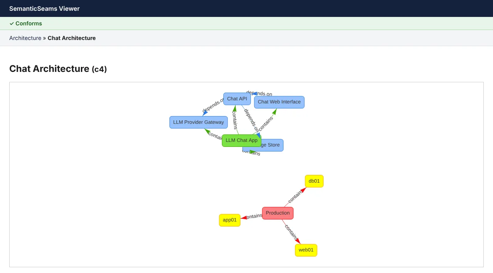
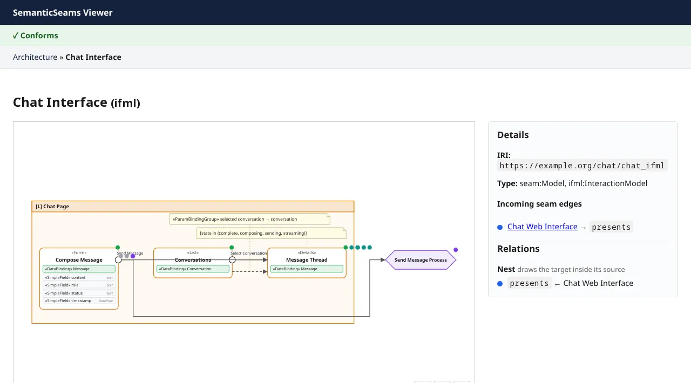
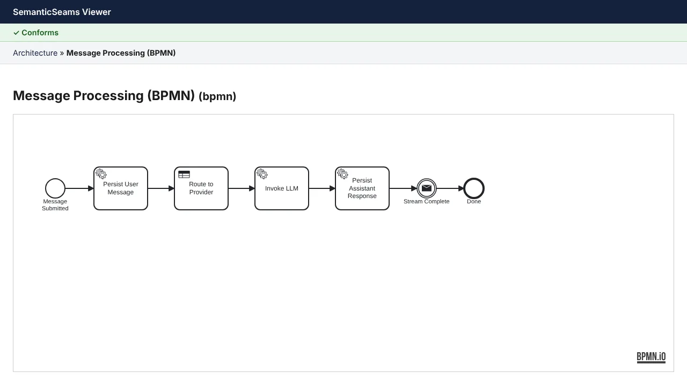
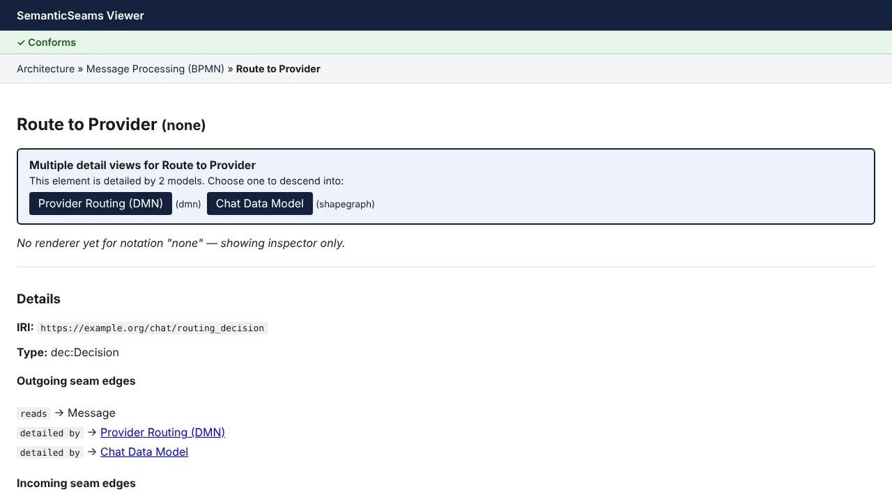
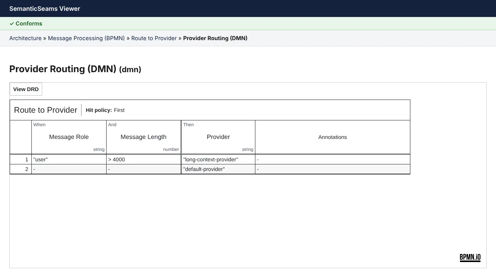
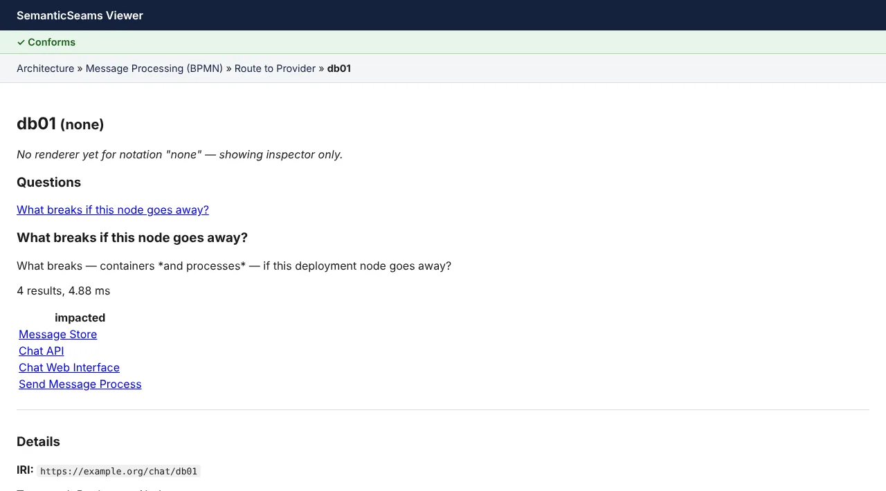

# Using the viewer

The viewer is a read-only browser over one model. Every click is an htmx request for
`/view/{iri}`, and the server picks a renderer from the `seam:notation` of the model the
element belongs to. This page walks the canonical descent through the chat-app example,
then explains the parts of the page and the URLs behind them.

The screenshots were taken from the running viewer in October 2026.

## The descent

### Architecture

The root of the chat app is its C4 architecture model: a system with four containers,
and the production environment with the nodes they are deployed to. The green bar above
the breadcrumbs is the model-health badge.

The architecture view has four zoom levels, chosen with the level toggle above the
canvas or `?level=` in the URL (default L2). Each level adds to the one before:

| Level | Shows |
|---|---|
| L1 System context | Systems, people and environments, with container edges rolled up to them |
| L2 Containers | Containers nested in their system, deployment nodes in their environment, `depends on` and `deployed to` edges |
| L3 Components and operations | The operations each container `seam:exposes`, nested in it, and `consumes` edges |
| L4 Seams | The targets of nest-mode seams nested in their source: the IFML model a container `seam:presents` and the process it `seam:executes`, each holding its model's top-level members in that layer's colour |

L4 is the nest reveal mode applied to the whole diagram: every seam predicate whose
`seam:reveal` is nest draws its target inside its source instead of as a separate view.
The nested models' own edges are not drawn. Clicking a nested model still opens it.

### Interface

Clicking **Chat Web Interface** follows `seam:presents` to the IFML model the container
presents: the chat page, its list, details and form components, the events on them, and
the flows between them.

### Process

Clicking **Send Message** follows `seam:triggers` to the process the event starts, and
one more hop along `seam:detailedBy` to the BPMN model that details it. The diagram is
the native XML, drawn by bpmn-js. Clicking a task that takes part in a seam navigates
again; a task's element ID in the XML is the fragment of its IRI in the graph.

The shapes take the process layer colour. Each task with a seam carries small badges at
its top edge, one per seam, coloured by the layer the seam leads to. Clicking a badge
follows that seam, and hovering one names it.

### A choice

The **Route to Provider** task is `seam:decidedBy` a decision that is detailed by two
models: the DMN decision model and the chat data model. Rather than pick one, the viewer
lists both with their notations and lets you choose.

### Decision

The DMN model opens in dmn-js. From its decision requirements diagram you can open the
decision table; clicking the table's name returns to the decision it stands for.

The decision diagram takes the decision layer colour, and the table's name carries a
decision-coloured edge. Like the BPMN tasks, the decision carries one badge per seam,
coloured by the layer the seam leads to; clicking a badge follows that seam. A seam back
to the model you are already viewing gets no badge.

### A question

Some elements have canned questions. On a deployment node, **What breaks if this node
goes away?** runs one SPARQL query and lists the containers and the process that depend
on it, each linked to its own view.

## The parts of the page

**Model-health badge.** Every page validates the whole model against the
[seam shapes](/reference/shapes). It reads *Conforms*, or a count of violations that
opens into a list naming each failing element.

**Breadcrumbs.** The path you clicked, not a fixed hierarchy: the same element can be
reached from more than one parent. Each crumb is a link back.

**The canvas.** Which renderer you get depends on the notation:

| Notation | Renderer |
|---|---|
| C4 architecture | Nested SVG cards laid out by ELK, with the zoom levels above |
| IFML interaction | IFML notation drawn as SVG on the server |
| Statechart | A node-link graph drawn with vis-network |
| BPMN | bpmn-js, from the model's native XML payload, tinted with the process colour and badged per seam |
| DMN | dmn-js, from the model's native XML payload: the decision diagram, tinted with the decision colour and badged per seam, and its tables |
| SHACL shape graph | The same ELK card renderer as C4: a frame per node shape, a card per property shape with its datatype (or target shape) and cardinality, and an edge for each `sh:class`/`sh:node` reference to another shape. A shape with no detail model of its own (e.g. ConversationShape) shows its model's shape graph with itself highlighted |

**Questions.** The canned queries that apply to the focused element's type, as buttons.
Results appear inline with each value linked. The catalog is on the
[query reference](/reference/queries).

**Details.** The inspector: the element's IRI, its types, its native element ID and
payload where it has them, and its outgoing and incoming seam edges with readable
predicate labels. Edges along a navigational predicate are links.

**Relations.** Under Details, the same seam edges grouped by the reveal mode
each predicate declares in `ontology/seam.ttl` (`seam:reveal`). **Open** edges
replace the view with the target's model. **Nest** edges (`presents`,
`executes`) draw the target inside its source. **Layer** edges overlay the target
on the view; until layer mode is built, a layer row is a plain link to the
target, resolved like any click. Each row shows the other end's layer colour, the predicate, an arrow
for direction and the label. Empty groups are left out.

## How a click is resolved

Navigation follows [ADR-0005](/adr/0005-navigation-resolution). The viewer does not keep
its own list of navigational predicates. Each seam predicate declares a reveal mode
(`seam:reveal`) in `ontology/seam.ttl`, and a predicate whose mode is open or nest
navigates. Today that is `seam:detailedBy`, `seam:triggers`, `seam:decidedBy` and
`seam:lifecycle` (open), and `seam:presents` and `seam:executes` (nest). Every other seam
predicate is layer, so it shows in the inspector but does not navigate. The JSON view
gives each seam edge its `reveal` mode beside `navigational`. When you click an element:

1. If it is detailed by exactly one model, the viewer opens that model.
2. If it is detailed by more than one, the viewer shows the choice.
3. If it has no detail of its own but a navigational edge leads to something that does,
   the viewer follows that one extra hop. It never goes further, so you never cross two
   layers without seeing the step between them.
4. Otherwise it opens the inspector for the element. A SHACL node shape with no detail
   model of its own (e.g. ConversationShape) also gets its model's shape graph on the
   canvas, with itself highlighted; the JSON view still reports its notation as none.

## URLs

Every state is a URL, so any view can be bookmarked or shared. The browser's Back and
Forward buttons walk the same URLs, and each step is rendered again from the server, so
the diagram comes back drawn and clickable.

| Route | Returns |
|---|---|
| `/view/{iri}?path=…` | The page for an element. `path` carries the breadcrumb trail. Add `format=json`, or send `Accept: application/json`, for the [view response contract](/adr/0004-view-response-contract) as JSON. |
| `/queries` | The canned-query catalog as JSON. |
| `/queries/{name}/{focus_iri}` | One query's rows for one focus element. |
| `/payload/{iri}` | The native BPMN or DMN XML behind a model, with its media type. |

## Current limits

The viewer is the v1 proof of concept. It is read-only, it loads one model, the chat-app
example in `examples/chat-app/chat-app.trig`, set by `DATA_PATH` and `ROOT_IRI` at the
top of `viewer/app.py`, and the statechart renderer does not yet draw containment as
nesting. The [backlog](/backlog) lists what comes next for the viewer.
