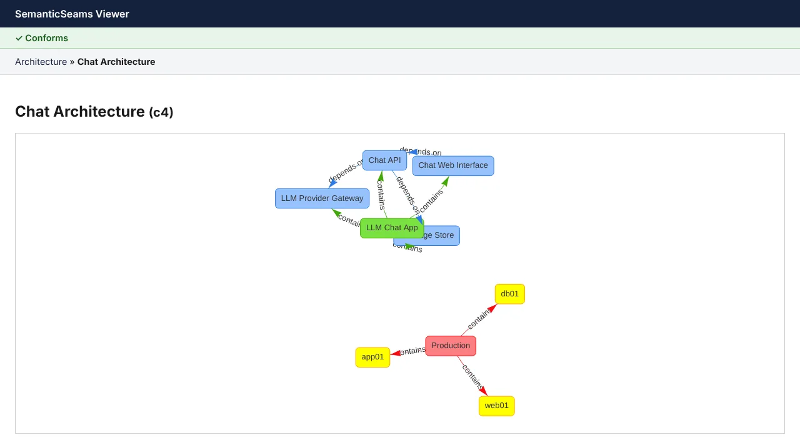
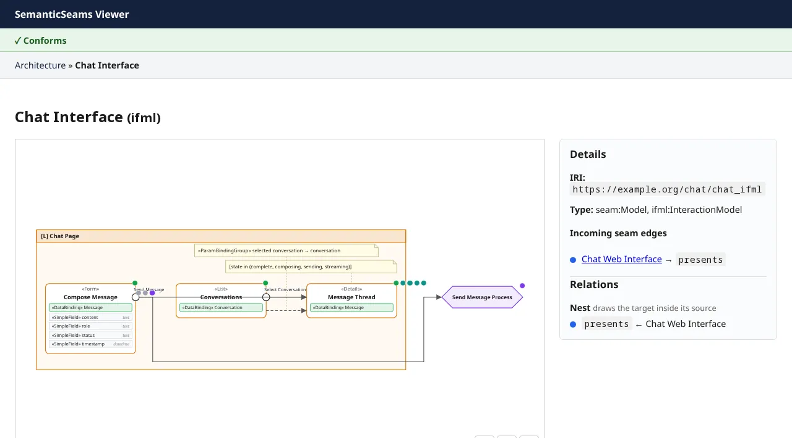
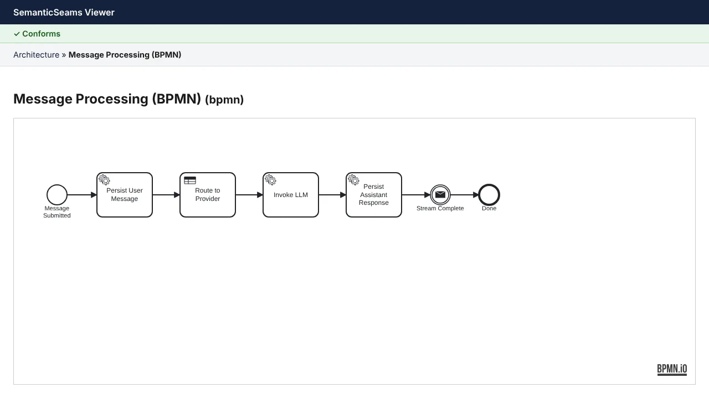
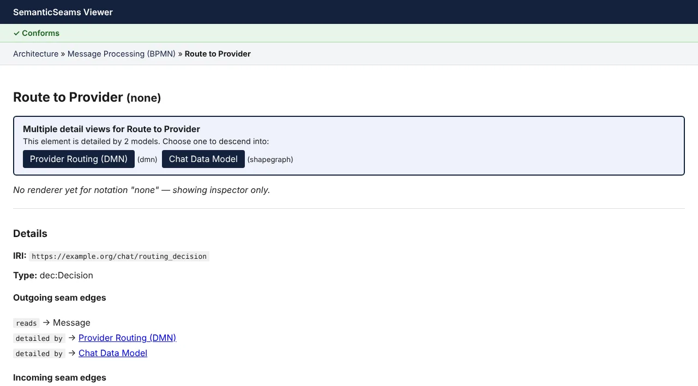
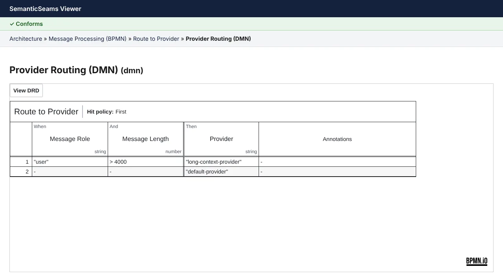
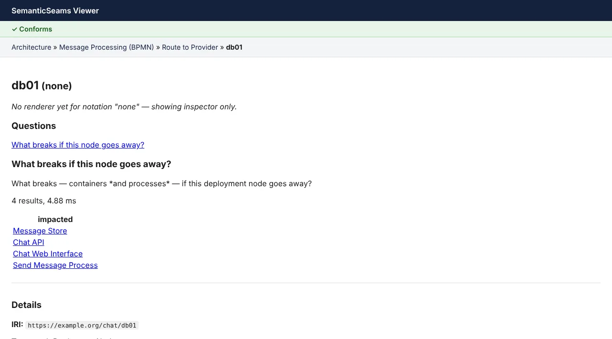

# Using the viewer

The viewer is a browser over one model, read-only unless you switch on
[edit mode](#edit-mode). Every click is an htmx request for
`/view/{iri}`, and the server picks a renderer from the `seam:notation` of the model the
element belongs to. This page walks the canonical descent through the chat-app example,
then explains the parts of the page and the URLs behind them.

The screenshots were taken from the running viewer in October 2026.

## The descent

### Architecture



The root of the chat app is its C4 architecture model: a system with four containers,
and the production environment with the nodes they are deployed to. The green bar above
the breadcrumbs is the model-health badge.

The architecture view has four zoom levels, chosen with the level toggle above the
canvas or `?level=` in the URL (default L2). Each level adds to the one before:

| Level | Shows |
|---|---|
| L1 System context | Systems, people and environments, with container edges rolled up to them; domains as frames around the systems and bounded contexts they `arch:contains`, labelled with their classification, and a `runs` edge from each context to each system whose containers present or execute its models ([ADR-0030](../adr/0030-domains-and-bounded-contexts.md)) |
| L2 Containers | Containers nested in their system, deployment nodes in their environment, `depends on` and `deployed to` edges |
| L3 Components and operations | The operations each container `seam:exposes`, nested in it, and `consumes` edges |
| L4 Seams | The targets of nest-mode seams nested in their source: the IFML model a container `seam:presents` and the process it `seam:executes`, each holding its model's top-level members in that layer's colour |

L4 is the nest reveal mode applied to the whole diagram: every seam predicate whose
`seam:reveal` is nest draws its target inside its source instead of as a separate view.
The nested models' own edges are not drawn. Clicking a nested model still opens it.

A model that declares no `arch:Domain` draws L1 as systems, people and environments
only. Domains and contexts, once declared, stay visible at every level, since levels
are cumulative.

### Interface



Clicking **Chat Web Interface** follows `seam:presents` to the IFML model the container
presents, drawn in IFML notation: the chat page container, its «List», «Details» and
«Form» components with their data bindings and fields, the events on their right border,
the Send Message Process action, and the navigation, data and action flows between them.
Drag to pan and use the +, − and fit buttons to zoom. Seam badges sit on the elements;
click an element or a badge to follow it.

### Process



Clicking **Send Message** follows `seam:triggers` to the process the event starts, and
one more hop along `seam:detailedBy` to the BPMN model that details it. The diagram is
the native XML, drawn by bpmn-js. Clicking a task that takes part in a seam navigates
again; a task's element ID in the XML is the fragment of its IRI in the graph.

The shapes take the process layer colour. Each task with a seam carries small badges at
its top edge, one per seam, coloured by the layer the seam leads to. Clicking a badge
follows that seam, and hovering one names it.

### A choice



The **Route to Provider** task is `seam:decidedBy` a decision that is detailed by two
models: the DMN decision model and the chat data model. Rather than pick one, the viewer
lists both with their notations and lets you choose.

### Decision



The DMN model opens in dmn-js. From its decision requirements diagram you can open the
decision table; clicking the table's name returns to the decision it stands for.

The decision diagram takes the decision layer colour, and the table's name carries a
decision-coloured edge. Like the BPMN tasks, the decision carries one badge per seam,
coloured by the layer the seam leads to; clicking a badge follows that seam. A seam back
to the model you are already viewing gets no badge.

### A question



Some elements have canned questions. On a deployment node, **What breaks if this node
goes away?** runs one SPARQL query and lists the containers, the process and the data
that depend on it, each linked to its own view. On the chat app's db01 that is six
results: the message store, chat API, web interface, send-message process, and the
Message and Conversation shapes stored in the message store (`seam:storedIn`,
[ADR-0011](/adr/0011-storage-resolution)).

## The parts of the page

**Model-health badge.** Every page validates the whole model against the
[seam shapes](/reference/shapes) and runs the storage checks of
[ADR-0011](/adr/0011-storage-resolution) (`ModelGraph.store_health()`). It reads
*Conforms*, or a count of violations that opens into a list naming each failing
element. A store the runtime could not resolve, such as a written shape with no
`seam:storedIn` or a store with an unsupported `deploy:storeKind`, counts as a
violation. A store container no shape is `seam:storedIn` adds an amber warning count
with its own list, and a model that declares no store gets a note that the runtime
keeps embedded SQLite at `SEAMS_DB`. The model review checks of `seams check`
(`seams.review_findings()`) add one warning each: lifecycle state labels copied into
a `sh:in` list, a `sh:class` that points at a shape, a shape with no `sh:targetClass`
and a `sh:path` nothing declares a property. Each names the shape or path (the
*focusNode*) and the fact (the *path*); the chat app shows eleven of them. A serving
container with more than one `deploy:replicas` on a store that is not PostgreSQL is a
violation (`ModelGraph.replica_health()`, [ADR-0038](/adr/0038-shared-stream-channel)),
since its replicas would not share process state. The static decision checks (`seams.decision_findings()`) add one warning
each too, listed just before the review warnings: a DMN `typeRef` the input's
`sh:datatype` does not fit, a gateway condition reading a variable nothing upstream
sets, and, for a `UNIQUE` decision table, each pair of rules that match the same input
and the first input no rule matches, with an example value. A shape result of severity `sh:Warning`, which is how a deprecated
vocabulary term is flagged ([ADR-0021](/adr/0021-vocabulary-versions)), is listed
first among the warnings, not counted as a violation. Warnings and notes leave the
badge at *Conforms*, and a review or decision check that fails is itself one warning.
A lifted IRI whose fragment is no `id` in its model's BPMN or DMN XML
([ADR-0002](/adr/0002-iri-identity-and-migration) rule 4), such as a seam edge left pointing at a task
removed from the diagram, is listed under *Lifted IRIs missing from the XML* with its
own red count; a payload file that is missing or not well-formed XML is one entry
naming the file. These findings leave the SHACL verdict as it is. Every committed
example has none.
A model with a `seam:Ontology` graph ([ADR-0022](/adr/0022-ontology-notation)) lists
each `owl:imports` beside the badge. One that resolves names the vendored version it
resolves to (*Import: gistCore14.0.0 (vendored)*). One that does not, an unknown IRI or
another gist version than the one in `ontology/vendor/`, is shown in red with the
`ResolutionError` facts: the ontology, `owl:imports` and what was expected. The viewer
loads with the import check off, so the model still opens and the class view still
draws the model's own classes, where `seams check` and `seams generate` refuse it. A
superclass declared neither in the ontology nor in a resolved import (a mistyped
`gist:Transation`) is one warning naming the class; none is given for an ontology
whose import does not resolve, since the import fault already explains it. Neither
changes the badge.
The JSON view's `modelConformance` carries the same `violations`, `warnings` and
`notes`, the lifted-IRI findings as `liftedIris`, and, for a model with an ontology,
each import's status as `ontologyImports`.

**Breadcrumbs.** The path you clicked, not a fixed hierarchy: the same element can be
reached from more than one parent. Each crumb is a link back.

**The canvas.** Which renderer you get depends on the notation:

| Notation | Renderer |
|---|---|
| C4 architecture | Nested SVG cards laid out by ELK, with the zoom levels above |
| IFML interaction | IFML notation on diagram-js: pan, zoom, seam badges; events on ELK ports, layout computed on the server; a modeler in [edit mode](#ifml-editing) |
| Statechart | A node-link graph drawn with vis-network |
| BPMN | bpmn-js, from the model's native XML payload, tinted with the process colour and badged per seam |
| DMN | dmn-js, from the model's native XML payload: the decision diagram, tinted with the decision colour and badged per seam, and its tables |
| SHACL shape graph | The same ELK card renderer as C4: a frame per node shape, a card per property shape with its datatype (or target shape) and cardinality, and an edge for each `sh:class`/`sh:node` reference to another shape. A shape with no detail model of its own (e.g. ConversationShape) shows its model's shape graph with itself highlighted |
| Ontology (class view) | The same ELK card renderer: a card per `owl:Class` with its label and `skos:definition`, the properties whose `rdfs:domain` it is nested inside it with their range, and a *subClassOf* edge to each superclass. A gist superclass is a grey, dashed, read-only card labelled from the vendored file; a superclass declared nowhere is an *Undeclared class* card. A click on a class shows its ontology's class view with the class highlighted |

**Questions.** The canned queries that apply to the focused element's type, as buttons.
Results appear inline with each value linked. The catalog is on the
[query reference](/reference/queries). A model view also offers the questions of each
element `seam:detailedBy` it, with the element's name in the button, because a click on
such an element lands on its model. The coverage questions work this way: a statechart
asks **Which transitions does nothing fire?**, an ODRL policy **Which permissions have
no deny test?**, and a BPMN view **Which paths does no scenario run? (Expense
Approval)** for its process. That last one lists each start-to-end path as its start,
its end and the BPMN ids in between, from
[`seams.coverage`](/reference/seams-library) rather than SPARQL, since sequence flows
live only in the BPMN XML.

**Sequences.** Beside Questions, links to the
[derived sequence diagrams](/concepts/diagrams-are-views#derived-sequence-diagrams)
of the IFML events the view is about. An IFML model lists its events. The BPMN process
view that a click on an event lands on lists that event, e.g. Send Message on the
Message Processing view. An event that opens in the inspector lists itself under
Details. A link draws one Mermaid diagram per path through the process's exclusive
gateways, headed by the flows it takes (*single* when there is no choice). Each
diagram's gaps, the seams the model does not declare yet, are listed under it.

**Storm.** Beside Sequences, links to the
[derived event storm](/concepts/diagrams-are-views#derived-event-storm) of the
processes the view is about: a process's own BPMN view, the BPMN view that a click on
its triggering event lands on, and an IFML model whose events trigger one, e.g. Expense
Approval from Submit Expense in chapter 10. A process started only through a channel,
such as Expense Payout, links from its own view. A link draws the timeline the
`seams storm` command prints: each step with its actor, command, aggregate, domain
event, decision, channel and started-process notes, then the read models and the gaps.

**Details.** The inspector: the element's IRI, its types, its native element ID and
payload where it has them, and its outgoing and incoming seam edges with readable
predicate labels. Edges along a navigational predicate are links. A data shape that
says where its rows live lists a **stored in** edge to its store, e.g. MessageShape
stored in Message Store.

**Relations.** Under Details, the same seam edges grouped by the reveal mode
each predicate declares in `ontology/seam.ttl` (`seam:reveal`). **Open** edges
replace the view with the target's model. **Nest** edges (`presents`,
`executes`) draw the target inside its source. **Layer** edges overlay the target
on the view; in the per-element view a layer row is a plain link to the
target, resolved like any click, and the [layer mode](#layer-mode) page draws them
all at once. Each row shows the other end's layer colour, the predicate, an arrow
for direction and the label. Empty groups are left out.

**Generated.** In the inspector, the generated files whose
[trace sidecars](/adr/0019-generation-trace) cite the element, each with the number
of its lines that do, e.g. ConversationShape in `generated/chat_api.py` and two
templates. The heading and each row open the [generation view](#generation-view),
a row on that file's first citing line. An element no generated line cites has no
Generated section.

## Generation view

`/generation/{iri}` shows how one element became code, read from the
`<output>.trace.json` sidecars `seams generate` writes beside each output
([ADR-0019](/adr/0019-generation-trace)) and listed in `seams.lock`. It is read-only,
except for [write-back](#write-back-from-output) in edit mode, and has three panes:

- **Model**: the element, then every model term the shown output cites, each with its
  layer colour, its qname and how many of the output's lines cite it.
- **Template**: the source of each template the shown output came from, with the lines
  behind the selected output line marked.
- **Output**: the generated file, one row per line. Lines citing the element are
  marked, and the selected line is highlighted.

Click an output line, a template line or a model term and every line the trace links
to it is highlighted in the other two panes. Below the panes, the **fan-out** lists
every generated line, in every output, that cites the element, grouped by file with
its generator. Each entry opens the view on that file and line
(`?output=…&line=…`); with no query the view opens the first citing line.

Nothing here fails on a bad file. A missing `seams.lock`, a missing or malformed
sidecar, an output that cannot be read and a template that cannot be found are each
one notice above the panes naming the file, and the rest of the view is built
without it. An element no generated line cites gets a notice saying so and no panes.
Outputs of a generator with no `trace` hook have no sidecar by design and get no
notice. The index is read once per viewer process, so regenerate and restart the
viewer to see new traces.

When `seams.lock` records drafts accepted by `seams propose`
([ADR-0020](/adr/0020-llm-drafts)), an **LLM drafts** list sits above the fan-out. Each
row gives the draft's file, its service task, provider and prompt template, and its
state, found by the same comparison `seams check` makes: *current*; *stale* when the
task's context hash no longer matches the record (a model fact the draft depends on
changed); *hand-edited* when the file's sha256 differs or the file is missing; or both.
A malformed draft record is one notice naming `seams.lock`.

## Layer mode

`/layers` (the **Layers** link in the page header) draws the whole loaded model at
once as six stacked planes, one per layer, top to bottom: architecture, interaction,
process, decision, data and lifecycle. Each plane holds its layer's elements, laid out
by ELK, with the edges between them, and is tilted by a simple oblique projection so the
planes read as a stack. The cards stay upright so their labels stay readable.

**Seams.** The lines between planes are the seams that cross layers, coloured by the
layer they start in. Which ones show is set by the **Seams shown** checkboxes, one per
reveal mode (`seam:reveal`, see [How a click is resolved](#how-a-click-is-resolved)).
Only **layer** seams are on at first, since those are the ones the flat views never
draw. **Open** seams (dashed) and **nest** seams (dotted) can be switched on. An open
seam that ends at a model is drawn to that model's name in the plane title.

**Hover.** Hovering an element, or a model name in a plane title, lights it, every seam
it takes part in, and the element at the far end of each, in any reveal mode, even
one that is switched off. That traces one element through the stack without clicking.

**Plane titles.** A plane's title opens that layer flat: it links to the layer's first
model in `/view`, and the layer's other models are listed beside it, each a link of its
own. A click on an element opens it in `/view`, resolved like any click.

**Elements in no layer.** An element in no model, or in a model whose notation maps to
no layer, is not drawn. It is listed above the canvas, with the reason, rather than
dropped silently, and so is a seam end that falls outside the six layers.

The page works for any model the viewer loads, including one with several models per
notation, such as the expense app's final checkpoint
(`examples/expenses/chapter-08/expenses.trig`). Add `format=json`, or send
`Accept: application/json`, for the same data as JSON: `layers` (per layer its `id`,
`label`, `models`, `nodes` and within-layer `edges`), `seams` (each with `source`,
`target`, `predicate`, `reveal`, `sourceLayer` and `targetLayer`) and `warnings`.

## Data health

`/data-health` (the **Data health** link in the page header) checks a running app's
data, not the model. It reads the SQLite store named by `SEAMS_VIEWER_STORE`, opened
read-only, so the viewer creates and writes nothing, and runs the attached domain
profile's instance-data rules on it: the profile's `sh:Warning` shapes with a
`sh:sparql` constraint ([ADR-0036](/adr/0036-cross-aggregate-invariants)). The stored
entities are lifted to RDF through their shape contracts and checked by
`seams_runtime.data_health`, the function `Runtime.data_health` calls, so the viewer
lists the same findings the runtime logs, sorted, one row per warning with its rule,
focus and message.

```sh
SEAMS_MODEL=examples/expenses/chapter-11 SEAMS_VIEWER_STORE=/tmp/seams.sqlite \
  uv run uvicorn viewer.app:app --port 8000
```

In chapter 11 an expense paid twice shows as one warning of the DDD profile's
paid-once rule, naming the expense; both payments stay stored. The view is computed on
every request, since the store changes under the viewer, and **Refresh** swaps it in
place. Without `SEAMS_VIEWER_STORE` the view says no store is configured; a model with
no profile has no rules to check. A store file that is missing or is not a seams
store, a profile that does not resolve, or a stored entity its shape contract refuses
is shown as an error naming it, not a page failure. Add `format=json` for `state`,
`store`, `profile`, `error`, `count` and `findings` as JSON.

## How a click is resolved

Navigation follows [ADR-0005](/adr/0005-navigation-resolution). The viewer does not keep
its own list of navigational predicates. Each seam predicate declares a reveal mode
(`seam:reveal`) in `ontology/seam.ttl`, and a predicate whose mode is open or nest
navigates. Today that is `seam:detailedBy`, `seam:triggers`, `seam:completedOn`,
`seam:decidedBy` and `seam:lifecycle` (open), and `seam:presents` and `seam:executes`
(nest). Every other seam
predicate is layer, so it shows in the inspector but does not navigate. The JSON view
gives each seam edge its `reveal` mode beside `navigational`. When you click an element:

1. If it is detailed by exactly one model, the viewer opens that model.
2. If it is detailed by more than one, the viewer shows the choice.
3. If it has no detail of its own but a navigational edge leads to something that does,
   the viewer follows that one extra hop. It never goes further, so you never cross two
   layers without seeing the step between them.
4. Otherwise it opens the inspector for the element. A SHACL node shape with no detail
   model of its own (e.g. ConversationShape) also gets its model's shape graph on the
   canvas, with itself highlighted; the JSON view still reports its notation as none.
   An `owl:Class` of a `seam:Ontology` model gets its model's class view the same way.

## Edit mode

Edit mode is off by default. Start the viewer with `SEAMS_EDIT=1` beside `SEAMS_MODEL`
to switch it on ([ADR-0017](/adr/0017-write-path-and-editor)). Saves change the model's
files, so point it at a copy when you only want to try it:

```sh
cp -r examples/expenses/chapter-08 /tmp/chapter-08
SEAMS_MODEL=/tmp/chapter-08 SEAMS_EDIT=1 uv run uvicorn viewer.app:app --port 8000
```

Any other value, or none, leaves the viewer read-only and the edit routes do not exist.

**Forms come from the shapes.** When some shape targets the element in view, its
inspector shows an **Edit** button. The form it opens has one field per property the
shapes give a path to: the seam shapes in `ontology/shapes/seam-shapes.ttl`, the same
ones the health badge checks, and any shapes in the model itself, through every SHACL
target kind. A field takes its name from `sh:name` or the property's label, offers a
list for `sh:in` and a checkbox for `xsd:boolean`, and shows a text input per value
otherwise. A value that is a blank node is shown but not editable here.

**Invalid values are saved and flagged.** A save never refuses a value for breaking a
shape ([principle 5](/project/principles)). A value that does not fit `sh:datatype`, or
one value too many, is written as typed, and the health badge at the top of the page
turns red with the new violation as soon as the save returns. Only faults the writer
cannot express are refused, such as a malformed IRI: the form names the subject, the
predicate and the reason, and nothing is written.

**Only `seams_edit` writes.** Each save is a `seams_edit` patch applied to the model's own
TriG files, so the diff is the changed triples, comments and layout are kept, and the
viewer never opens a model file for writing itself. The server log records each save
with the element, the field, the file and the quads added and removed.

**Undo.** After a save, an **Undo** button reverses the newest edit of the session, byte
for byte, and reloads the page. The history is held in memory, so it ends when the
viewer stops. **Done** closes the form and shows the refreshed view.

**BPMN and DMN open in the modelers.** In edit mode a BPMN view loads the bpmn-js
modeler and a DMN view the dmn-js modeler in place of the viewers, with a bar above the
canvas. Edit the diagram there as in any bpmn.io tool, then press **Save**: the
modeler's XML goes to `POST /edit/payload/{model}`, and `seams_edit` checks it is
well-formed and writes it over the payload file. XML that does not parse is refused with
a message naming the file and the reason, and nothing is written.

**Renaming an element id rewrites its seam edges.** Select an element, type the new id in
the bar's *Element id* field and press **Rename id**, then Save. Because a lifted
element's IRI is the model IRI plus its id ([ADR-0002](/adr/0002-iri-identity-and-migration)), the save
renames it everywhere at once: the `id` and every reference to it in the XML
(`sourceRef`, `targetRef`, `href="#…"`, `bpmnElement` and the rest), every quad in the
seams graph whose subject or object is the old IRI, and a decision's `dec:payloadElement`
when it names the old id. On the chat app, renaming `persist_user_msg` in the message
processing model moves its `seam:inModel`, `seam:invokes`, `seam:writes` and `seam:fires`
edges to the new IRI. An id that is
not in the XML, or a new id already in use, is refused naming the element, and any
rename the save had already written is rolled back. The XML and the TriG files change
together or not at all, and the server log records each save with its renames and the
files touched. After a save the page reloads; one **Undo** reverses the whole save, renames
included, byte for byte. An id changed in the XML outside the viewer does not move the
seam edges, and the health badge then lists the old IRI under *Lifted IRIs missing
from the XML*.

### IFML editing

In edit mode the IFML view is a diagram-js modeler. A bar above the canvas holds a
*Name of a new element* field, **Undo** and a status line; the canvas gets a palette and,
on the selected element, a context pad. Each gesture is one change to the model:

| Gesture | Change |
|---|---|
| Drag **ViewContainer**, **List**, **Details**, **Form** or **Event** from the palette into its parent | Creates the element, named from the bar's field (or a prompt when it is empty). A view container goes on the canvas or into another container, a component into a container, an event onto a container or component. |
| **NavigationFlow** in the palette, or the context pad's connect on an event, then drag to a container or component | Connects the event to it with an `ifml:NavigationFlow`. |
| Drag a container or component into another container | Moves it there: the `ifml:contains` triple changes, and so does the component's `ifml:order` when the new container already uses it. |
| Click a form's field row, then the pad's **− field** | Removes that property from the shape the form `seam:writes`, with each form input `ifml:boundTo` it on a form that writes the shape. |
| The pad's trash on an element or a flow | Deletes it with what it contains, its events, and every flow from or to any of them. |

A new element's IRI is its name in its parent's namespace
([ADR-0002](/adr/0002-iri-identity-and-migration)), so a name already in use is refused.
A drag that stays inside the same container saves nothing: positions are computed from
the model, not stored in it. Selecting an element opens its form from the shapes below
the canvas, as the **Edit** button does elsewhere.

Each gesture posts one op to `POST /edit/ifml/{model}`. The server builds a
`seams_edit` patch, writes it, puts it on the undo stack and answers with the redrawn
diagram, the health badge and the live preview, so the canvas, the badge and the
generated pages update together. The status line names the op, the element and the
quads each file gained and lost. An op the model cannot take is refused: the status
line shows the subject, the predicate and the reason, nothing is written, and the
canvas stays as it was. The server log records each op with its kind, the element, the
files and the quad counts, and each refusal with the same three facts.

What the diagram does not make, the forms do: a new page needs its `ifml:path` and
`ifml:title`, and a new List or Details its `seam:reads`, before the htmx generator can
render it, and the live preview names the missing fact until then. The htmx generator
also expects one navigation flow per event, so wiring a second flow from an event shows
as a lenient fault in the preview.

### Live preview

In edit mode a preview pane sits beside the view. It runs the generators of the
`seams.toml` project beside the loaded model on the model as it is now, in lenient mode
and in memory: nothing is written, so the committed `generated/` files and `seams.lock`
do not change. The pane lists each output by its path in the project, with the
generator that wrote it and its text, so after a save you can open the regenerated page
and read the change. A save from a form sends the refreshed pane back with the form, next
to the refreshed health badge; a BPMN or DMN save and **Undo** reload the page, which
loads the pane again.

When a generator cannot produce an output for the edited model, the pane turns amber and
says *lenient*, with one line per fault naming the generator, the reason, the subject and
the predicate; the other outputs are still listed. On the expense tutorial, pointing the
*My Expenses* list's `seam:reads` at a shape the model does not describe flags the htmx
generator's fault. A model with no `seams.toml` beside it shows *no project* and the
reason instead. The server log records each preview with the project, the number of
outputs and faults, and how long it took.

### Write-back from output

In edit mode the generation view's output pane can change the model. Below the output
sits a one-line editor holding the selected line; click another line to edit that one
instead. Change the text and press **Preview write-back**. Nothing is written yet: the
viewer works out which model fact the edit stands for and whether the model, changed
that way, would generate exactly what you typed.

**One literal, or a refusal.** The changed span is what lies between the line's
unchanged start and end. The viewer looks at the model terms the line's trace cites
([ADR-0019](/adr/0019-generation-trace)) and their literal values, and keeps the ones
written on the old line over the whole span. Exactly one must remain. On the chat app,
changing `<title>Chat</title>` to `<title>Chat room</title>` in a page template finds
`:chat_page ifml:title "Chat"@en` and drafts a patch that replaces that one triple with
`"Chat room"@en`, keeping the language or datatype and the named graph. When no
literal covers the span, or more than one does (the *Send Message* button's line is
covered by three), the edit is refused, and the refusal lists the candidates in sorted
order. Only literal values can be written back this way: labels, titles, paths. An edit
to fixed template text, or a structural change, is refused.

**The edit must regenerate to itself.** The viewer applies the patch to a temporary
copy of the model and runs the `seams.toml` project's generators on it. The output you
edited must come back equal to your edit. The model-hash lines differ as well, and
they are not counted. When the output comes back different, the edit is refused and
the first differing line is named. Typing a raw `&` into a page template is refused
this way, for example, because the template escapes it to `&amp;`. A generator fault
on the patched model is also a refusal. The model's own files are never opened during
this check.

**Effects come first.** A drafted write-back shows the patch triple, the files it
touches, and every other output line that the same patch changes, as before and after
pairs. Renaming the *Conversations* list in the chat app also changes a line in
`conversation_list.html`. Read them, then press **Apply to the model**.

**Apply checks again.** Apply runs the whole check again on the model as it is now, so
a preview left open across other edits cannot write a patch that no longer reproduces
the edit. The patch is then written through `seams_edit` like any other save: one
triple in the TriG file, comments and layout kept. It goes on the session's undo
stack, so **Undo** restores the bytes. Apply changes the model, not the outputs: run
`seams generate` to rewrite the files in `generated/`. A refusal names the subject,
the predicate and the reason, and writes nothing. The server log records each drafted,
refused and applied write-back with the output and line, the subject, the predicate,
the old and new values and the files.

#### Structural edits: adding or removing a form input

Below the line editor, **Edit output** opens the whole output in one text area. Add or
remove one form input in a generated htmx page and press **Preview structural edit**. The
viewer drafts a model patch for it, and accepts the patch by the same rule as a literal:
regenerating with it must give back what you typed.

**One block, one control.** The viewer diffs the output against your text by line, and
the change must be one contiguous block. The block may also change the lines beside the
input, such as the form's *set by the runtime* comment, which lists the fields the form
leaves out. Inside the block exactly one `input`, `textarea` or `select` with a `name`
must appear or disappear. The form is found from the trace
([ADR-0019](/adr/0019-generation-trace)): the nearest traced lines above and below the
block must both name the same `ifml:Form` with a `seam:writes` shape. An input line
itself traces only the written shape.

**What the patch contains.** Removing the chat app's message input from the compose
form drops the form's one `ifml:hasParameter` bound to a path named `content`: every
triple with `:message_input` as subject, and the `hasParameter` triple, each in its own
graph. Adding an input mints the parameter `<name>_input` in the form's namespace and
gives it `a ifml:Parameter`, the label `"<name> input"`, `ifml:boundTo` the path, the
form's `seam:inModel` and the form's `ifml:hasParameter`, in the form's graph. When the
written shape already has a `sh:property` path with the control's name, the parameter is
bound to it. Otherwise the path is minted in the shape's namespace and declared
`a rdf:Property`, and a blank-node `sh:property` is added to the shape. Its values come
from the control you typed: `sh:datatype` (and `dash:editor`) from the element, by the
htmx generator's field kinds read backwards (a `textarea`, an `input type="text"` or an
`input type="datetime-local"`), `sh:maxLength` from `maxlength`, `sh:minCount 1` from
`required`, and `sh:name` from the name. Nothing in the patch is a fixed value.

**The edited block must regenerate to itself.** The patch is applied to a temporary
copy and the generators run, as for a literal. Every line of the output must come back
as you typed it, model hashes aside. A line outside your block that the patch also
changes is allowed and listed as an effect: on the chat page a new message field also
shows in the message thread, a `Details` of the same shape. Effects on other outputs are
listed too, and all of them come before **Apply to the model**. A new path's
`sh:property` has no `sh:order`, so the generator puts it after the ordered fields; an
input typed anywhere else is refused with the first differing line.

**Refusals.** The viewer refuses, naming the subject, the predicate and the reason, and
writes nothing, when the edit changes more than one block, adds or removes no named
control or several, lies inside no form with `seam:writes` (an input typed into
`<head>`, say), regenerates differently, mints a parameter IRI that is already in the
model, removes a parameter that something other than its form refers to, or adds a new
path through a control no field kind writes, such as a `select`. Apply checks again on
the current model and writes the patch through `seams_edit` onto the undo stack. The
server log records each drafted, refused and applied structural edit with the output,
the subject, the predicate, the reason or the kind, and the files.

### Domain profiles

A model can attach to a domain profile with one triple in its seams graph,
`seam:conformsTo <profile IRI>` ([ADR-0018](/adr/0018-domain-profiles)). The profile is a
package in the model's directory, `profiles/<name>/profile.ttl`: the viewer reads every
`profiles/*/profile.ttl` and uses the one that states `<profile IRI> a seam:Profile`. It
is kept apart from the model, so attaching or changing a profile leaves the model hash,
the generators' input and `seams.lock` unchanged. In edit mode a profile changes four
things:

- **The palette.** Above the preview pane, a list of the classes the profile offers
  (`seam:offersClass`), in IRI order, under the profile's labels: `skos:prefLabel`, else
  `rdfs:label`, else the label the editor shows without a profile.
- **Out-of-profile classes are flagged, not refused.** Health adds one warning per
  element whose `rdf:type` is neither a class the profile offers nor a subclass of one.
  Saves still go through ([principle 5](/project/principles)).
- **The profile's shapes join health and the forms.** The shapes files the profile names
  with `seam:profileShapes` are merged with the seam shapes, so their violations show on
  the health badge, and a property they give a path to gets a field in the element's form.
- **The preview runs only the profile's generators.** Only the project's generators named
  by `seam:usesGenerator` run. A listed name the project's `seams.toml` does not configure
  is shown as not configured. `seams generate` ignores profiles; `seams check` validates
  the profile's shapes ([ADR-0033](/adr/0033-ddd-profile)).

A part the profile leaves out restricts nothing (ADR-0033 section 3): a profile with no
`seam:offersClass` shows no palette and flags no class, and one with no
`seam:usesGenerator` previews every configured generator. Expense chapter 11's DDD
profile is such a profile, a shapes library and nothing else. Its rules' violations
show in health like any other shape's, with the rule's message and the focus node.

**Type pills.** A profile's labelled `sh:Info` shapes are type pills, not rules
([ADR-0033](/adr/0033-ddd-profile) section 4), so their results are not shown in health.
Instead, an element's heading shows a pill with the shape's label (`skos:prefLabel`, else
`rdfs:label`) when the element is one of the shape's targets and conforms to it. The
viewer works them out from the same SHACL run as health, adds no `rdf:type` to the model,
and lists them by label then shape IRI. In chapter 11 `ExpenseShape` and the `Expense`
class show *Aggregate*, the operations a UI event submits to show *Command*, and the
lifecycle transitions and `vendor_changes` channel show *Domain event*: the words are the
DDD profile's, not the viewer's. A model with no profile shows no pills.

The health panel names the attached profile with its class and generator counts, and the
server log records one line when the model loads, naming the profile IRI and the same
counts. A profile that cannot be resolved (no `profile.ttl` declares the IRI, two do, the
model names two profiles, or a file does not parse) shows in the health panel in red with
the subject, the predicate and the detail, and the viewer carries on as if no profile were
attached. A model with no `seam:conformsTo` behaves as before: no palette, the same health
and every configured generator in the preview.

## URLs

Every state is a URL, so any view can be bookmarked or shared. The browser's Back and
Forward buttons walk the same URLs, and each step is rendered again from the server, so
the diagram comes back drawn and clickable.

| Route | Returns |
|---|---|
| `/view/{iri}?path=…` | The page for an element. `path` carries the breadcrumb trail. Add `format=json`, or send `Accept: application/json`, for the [view response contract](/adr/0004-view-response-contract) as JSON. |
| `/queries` | The canned-query catalog as JSON. |
| `/queries/{name}/{focus_iri}` | One query's rows for one focus element. |
| `/sequence/{event_iri}` | The [derived sequence diagrams](/concepts/diagrams-are-views#derived-sequence-diagrams) of one IFML event as JSON: per diagram its `name`, `path`, `gaps` and `mermaid` text. Add `format=html` for the drawn fragment. Anything that is not an `ifml:Event` is a 404. |
| `/storm/{process_iri}` | The [derived event storm](/concepts/diagrams-are-views#derived-event-storm) of one process, or of the process an IFML event `seam:triggers`, as JSON: `process`, `label`, `steps` (each with its `index`, `iri`, `name` and `entries`), `readModels`, `gaps` and the `markdown` timeline. Add `format=html` for the fragment. Anything that is neither is a 404 naming it. |
| `/layers` | [Layer mode](#layer-mode): the six layers as stacked planes with the seams between them. Add `format=json`, or send `Accept: application/json`, for `layers`, `seams` and `warnings` as JSON. |
| `/data-health` | The [data-health view](#data-health): the attached profile's instance-data warnings on the store at `SEAMS_VIEWER_STORE`, read-only. An htmx request gets the fragment alone. Add `format=json` for the findings as JSON. |
| `/generation/{iri}?output=…&line=…` | The [generation view](#generation-view) of an element: model, template and output panes joined by the trace sidecars, and the fan-out of every generated line citing it. `output` and `line` pick the file and line shown; an unknown one falls back to the first citing line. |
| `/payload/{iri}` | The native BPMN or DMN XML behind a model, with its media type. |
| `/edit/{iri}` | [Edit mode](#edit-mode) only: `GET` returns the element's form; `POST` saves one field and returns the form with the refreshed health panel and live preview. |
| `/edit/payload/{iri}` | Edit mode only: `POST` with JSON `{"xml": …, "renames": [{"old": …, "new": …}]}` renames each id through the seams graph and saves the BPMN or DMN model's XML; returns JSON with the files touched, or a 409 naming the subject, predicate and reason when nothing was written. |
| `/edit/ifml/{iri}` | Edit mode only: `POST` with JSON `{"op": "create" \| "connect" \| "move" \| "delete" \| "remove_field", …}` applies one [IFML diagram op](#ifml-editing) to the IFML model; returns JSON with the files touched, the redrawn diagram and the health and preview markup, or a 409 naming the subject, predicate and reason when nothing was written. |
| `/generation/writeback/preview` | Edit mode only: `POST` with form fields `output`, `line` and `text` drafts the [write-back](#write-back-from-output) of one edited output line and returns the patch, the regeneration check and the other lines it changes, or the refusal naming the subject, predicate and reason. Writes nothing. |
| `/generation/writeback/apply` | Edit mode only: `POST` with the same fields checks the write-back again on the current model, then writes the one-triple patch through `seams_edit` and puts it on the undo stack; a refusal writes nothing. |
| `/generation/structural/preview` | Edit mode only: `POST` with form fields `output` and `text` (the whole edited output) drafts the [structural edit](#structural-edits-adding-or-removing-a-form-input) that adds or removes one form input and returns the kind, the field, the form, the parameter, every patch triple, the files and the effects, or the refusal naming the subject, predicate and reason. Writes nothing. |
| `/generation/structural/apply` | Edit mode only: `POST` with the same fields drafts the structural edit again on the current model, then writes its patch through `seams_edit` and puts it on the undo stack; a refusal writes nothing. |
| `/edit/undo` | Edit mode only: `POST` reverses the newest edit of the session. |
| `/edit/preview` | Edit mode only: `GET` returns the [live preview](#live-preview): the project's generators re-run in lenient mode, in memory, on the loaded model. Add `oob=true` to mark it for an out-of-band swap. |

## Current limits

The viewer is the v1 proof of concept. It loads one model, chosen by
the `SEAMS_MODEL` environment variable (default the chat-app example in
`examples/chat-app/chat-app.trig`). `SEAMS_MODEL` may name a TriG file or a directory
of TriG files loaded together, as the seams library's `seams.load` reads them; payload
files sit beside the file, or in the directory. The root view is
the model's single C4 `seam:Model`, or `SEAMS_VIEWER_ROOT` when set; with no C4 model,
or more than one, the viewer refuses to start and names the candidates. The statechart
renderer does not yet draw containment as nesting. Edit mode edits one field of one
element at a time through forms, BPMN and DMN only through their modelers, and IFML on
its diagram: it does not create or delete other seams-graph elements, or edit the C4 or
statechart diagrams yet. Write-back from the generation view changes one literal per edit, or adds or removes
one form input per edit; other structural edits from the output are not proposed yet. The IFML modeler makes navigation flows only (a data flow is
made through the route), and does not set a flow's swap. The modelers do not lift a new BPMN or DMN element into the seams graph, and its
undo history lasts only as long as the viewer runs. A domain profile's palette lists the classes on offer, but the editor cannot yet add an element from it. The live preview shows the generated text, not the page served, and a form save waits for it, so a project with slow generators makes saves slow. The [backlog](/backlog) lists what comes next for the viewer.
