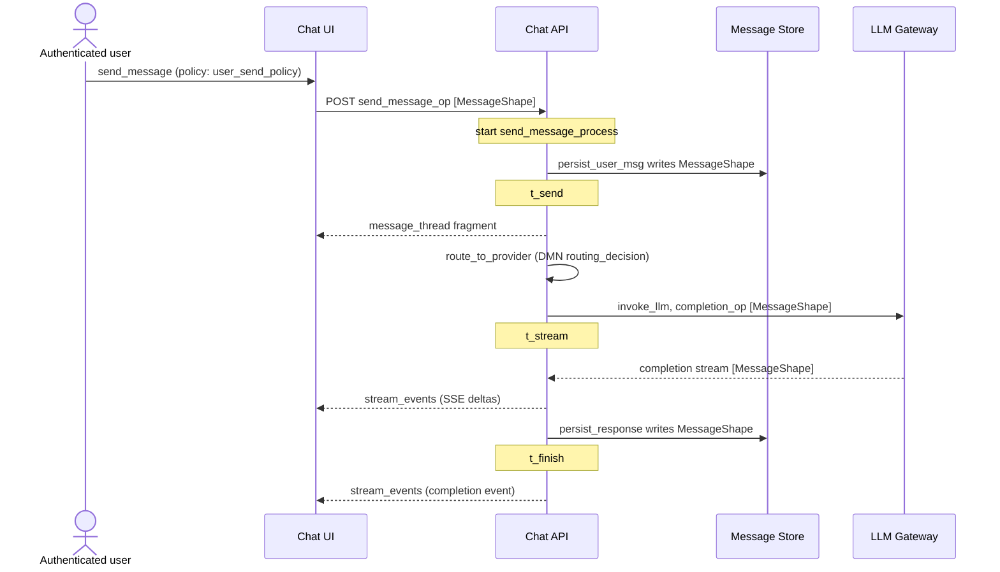

# Research note: UML coverage, derived diagrams, and what a builder still lacks

*Status: proposal, 2026-10-29. Not yet triaged into the [backlog](../backlog.md).
Written against `main` at `dd56985`.*

## The question

UML has fourteen diagram types and SemanticSeams integrates none of them by name.
Sequence diagrams in particular are what most engineers reach for when they explain a
feature. Does the project need a UML layer, or can the diagrams be derived from the
graph that already exists? And setting UML aside, what does an application builder need
that the model does not yet hold?

## Short answer

**No UML layer is needed, and authoring UML would break the project's own core rule.**
Every UML diagram is either already covered by a pillar notation, or derivable from
seams that already exist. Authoring them by hand would create a second source of truth
for facts the graph already holds, which is exactly the drift the
[product brief](../../orig_convo/product-brief.md) promises to end.

**The sequence diagram is the one worth building, as a derived view.** A walk over the
chat app's real graph (below) shows that every lifeline and almost every message of the
send-message sequence already exists as a seam edge. Two small facts are missing.

**The real gaps are not diagrams.** They are kinds of information the graph does not
hold yet: requirements and their verification, failure behaviour, the hook for
hand-written code, data residency and schema evolution, observed runtime behaviour, and
scheduled work. Several of these are also what derived diagrams need in order to be
complete.

## 1. UML diagram by diagram

The test for each: is the information already in the graph, and if so, who would read
the diagram?

| UML diagram | Where its information lives today | Verdict |
|---|---|---|
| Class | SHACL shapes: properties, datatypes, `sh:node`/`sh:class` as associations, cardinalities | **Derive.** This is the ShapeGraph renderer (backlog item 9, M007/S03). Draw it in class-diagram style; builders know that notation |
| Object | Instance data validated by shapes: `seed.json`, the runtime store | **Derive**, cheaply, as a debugging aid once the store is queryable from the viewer |
| Package | `seam:Model`, named graphs (ADR-0001), `arch:contains` | **Already covered** by C4 levels |
| Component | C4 L3 (`arch:Component`); `seam:exposes`/`seam:consumes` are provided and required interfaces | **Already covered.** Lollipop notation adds nothing for this persona |
| Composite structure | C4 nesting plus ports | **Skip** |
| Deployment | `deploy:` and `seam:deployedTo` | **Derive.** The data exists; no renderer shows it as a deployment map yet |
| Profile | `seam:Profile` (reserved) | **Already planned** as SHACL profiles |
| Use case | Actors are ODRL parties; use cases are IFML events that trigger processes; "actor may do X" is `seam:governedBy` | **Derive**, partly. The projection is the compliance query drawn as a picture. The goal behind a use case is not in the graph (section 3.1) |
| Activity | BPMN | **Superseded** |
| State machine | `state:` statecharts | **Already covered** |
| Sequence | Spread across IFML, comm, BPMN and deploy, joined by seams | **Derive. Highest value** (section 2) |
| Communication | Same facts as sequence, laid out as a graph | **Derive for free** from the sequence projection; low value |
| Timing | Needs latency budgets or observed durations | **Derive later** from traces (section 3.5). The waterfall view of a trace viewer is a timing diagram |
| Interaction overview | BPMN | **Superseded** |

Two diagrams outside UML are worth naming because they fall out of the same facts:

- **Data-flow diagram for threat modelling.** STRIDE-style reviews run on a data-flow
  diagram with trust boundaries. Processes, data stores and flows are already seams, and
  the trust boundaries are deployment nodes and environments. This serves the enterprise
  persona and the authorization pillar directly.
- **Model diff view.** A pull request that changes the model should show "this adds an
  edge from a screen to `ExpenseShape`", not a Turtle diff. It is a named-graph diff
  drawn with the existing renderers.

### Where SysML v2 points the same way

The OMG adopted SysML v2, KerML and the Systems Modeling API in July 2025. Three of its
ideas match this project closely and are worth borrowing as vocabulary:

- **Views and viewpoints are model elements.** A view is a query plus a rendering, and
  is itself part of the model. That is "diagrams are views", stated by a standards body.
  A derived sequence diagram would be a saved query bound to a renderer, which is how the
  query catalog in `docs/queries/` already works.
- **Requirements, verification and allocation are first-class.** These are the gaps in
  section 3.1.
- **The API treats the model as commits and branches.** That supports the outline's
  event-sourcing plan and gives a reference shape for a future write API.

The lesson from SysML v1 also holds: tools that let people author every diagram
independently ended with diagrams that disagree. The fourteen-diagram menu is part of
why UML "failed socially", as the outline puts it.

## 2. The sequence diagram, derived from the chat app

Walking `examples/chat-app/chat-app.trig` from the `:send_message` event:

| Sequence element | Graph fact it comes from |
|---|---|
| Actor lifeline | `:send_message seam:governedBy :user_send_policy`, whose assignee is `:authenticated_user` |
| Chat UI lifeline | `:chat_ui seam:presents :chat_ifml`, which holds the event |
| UI to API message | `:send_message seam:submitsTo :send_message_op`, exposed by `:chat_api` |
| API starts the process | `:send_message seam:triggers :send_message_process`; `:chat_api seam:executes` it |
| Ordering of steps | BPMN `sequenceFlow` in `chat_process.bpmn`. **Not in the graph** |
| Decision call | `route_to_provider seam:decidedBy :routing_decision` |
| API to LLM gateway | `invoke_llm seam:invokes :completion_op`, exposed by `:llm_gateway` |
| Payloads on each arrow | `seam:acceptsShape` and `seam:returnsShape` |
| Writes to storage | `seam:writes :MessageShape`. **Which container stores it is not in the graph** |
| Fragment back to the UI | `:send_message_op seam:rendersComponent :message_thread` |
| Async push to the UI | `stream_complete_event seam:publishesTo :stream_events`; `:chat_ui seam:consumes` it |
| State notes | `seam:fires :t_send`, `:t_stream`, `:t_finish` |
| Guard notes | `seam:governedBy` on the event and the operation |

Rendered in Mermaid, every line of this diagram comes from the facts above:

What the derivation needs that the graph lacks:

1. **Step ordering.** Control flow stays in the BPMN XML by design (the README's
   "deliberate omissions"). The deriver can read the XML, as the runtime already does
   through SpiffWorkflow. No vocabulary change is needed. For gateways, derive one
   sequence per path, or per DMN test case, rather than drawing `alt` fragments.
2. **The storage lifeline.** `:message_db` is a container deployed to `:db01`, but no
   seam says that `MessageShape` lives there. The "Message Store" lifeline above was
   placed by hand from `arch:dependsOn`. This same gap means the impact query cannot
   answer "which data becomes unavailable if `db01` goes away". A seam from a shape to
   the container that persists it would earn that query, which satisfies design rule 2.
3. **The delta stream.** The runtime publishes LLM deltas from `invoke_llm` to the one
   channel its process publishes to (`process_channel` in `seams_runtime/model.py`). The
   graph declares only the completion event. A derived diagram shows the delta arrow
   only because this note added it. Behaviour the runtime infers is behaviour the views
   cannot show.

The third point generalises: **deriving a view is a cheap audit of the model.** Every
arrow the deriver cannot place is either a missing fact or runtime behaviour that
bypasses the graph.

### Two sequence diagrams, not one

- **As designed:** derived statically, as above, per scenario.
- **As executed:** the worker already records one trace row per element with the task,
  the operation, the container, writes, publishes and status transitions
  (`seams_runtime/worker.py`). Mapping each row's IRIs to lifelines gives a sequence
  diagram of a real run with no new instrumentation. Emitting the same rows as
  OpenTelemetry spans, with element IRIs as span attributes, would make the run visible
  in Jaeger or Tempo too.

Comparing the two is the behavioural counterpart of the deployment drift detection the
outline already plans: "the model says the API calls the gateway once; production
called it three times."

Mermaid is the right first output. GitHub and most documentation tools render it, so
derived diagrams can sit in pull requests and READMEs without the viewer. An interactive
renderer in the viewer can come after.

## 3. What a builder needs that the model does not hold

Ordered by value to the solo-operator persona, with what each would earn.

### 3.1 Requirements, scenarios and verification

There is nowhere to say why an element exists or how anyone knows it works. The outline
lists test specifications as an annotation vocabulary, but nothing ships.

- **Scenarios** are the missing input to sequence derivation, and they double as
  acceptance tests: "an employee submits a 40-euro expense; it is auto-approved."
- **Derived tests** fit the generation story. DMN tables carry test cases by standard.
  SHACL shapes can carry valid and invalid examples. Policies imply allow and deny tests
  per role. BPMN paths imply scenario tests.
- **Coverage becomes a query:** which BPMN paths no scenario exercises, which transitions
  no task fires, which policies have no deny test.
- **Requirement traceability** (a requirement satisfied by elements, verified by
  scenarios) matters more to the enterprise persona. A thin vocabulary in the SysML v2
  shape is enough.

### 3.2 Failure behaviour

No vocabulary mentions errors, timeouts, retries, compensation or boundary events.
Operations declare a returned shape but no error shapes. Real processes spend much of
their logic on failure paths, and the sequence diagram's most useful fragments are the
failure ones. Minimum useful step: error shapes on operations (problem+json), and
lifting BPMN error boundary events that take part in a seam.

### 3.3 The hook for hand-written code

The worker's `_invoke` is specific to LLM completion: it builds chat messages and
streams tokens. A builder whose service task must call a payment API, send an email or
run custom code has no declared place to put it. This is the "expressiveness cliff" the
outline names as a killer of visual programming. The expense-approval tutorial (E1) will
probably meet it at "notify the manager" or "pay the expense". It needs a seam from an
operation to the code or external endpoint that implements it, and a rule for where
hand-written code lives so regeneration never overwrites it.

### 3.4 Data residency and schema evolution

Two related gaps:

- **Residency**, as section 2 found: no edge from a shape to the store that holds it.
- **Evolution:** ADR-0002 covers renaming IRIs, but not changing a shape when data
  already conforms to the old one. For a solo operator, "I added a required field and my
  existing rows broke" is the first post-launch pain. A shape diff between two model
  versions can classify changes as compatible or breaking, and can drive a generated
  migration or a deploy-time refusal. The same diff, applied to `seam:acceptsShape` and
  `seam:returnsShape`, is API breaking-change detection.

### 3.5 Observed behaviour

The as-deployed graph is planned for infrastructure, but nothing yet feeds back what the
application did. Trace rows are already produced (section 2). An as-observed named graph
gives as-executed sequence and timing diagrams, model conformance checks, and dead-model
detection: elements no request ever reached.

### 3.6 Scheduled and background work

Nothing models timers or recurring jobs, and most applications have them: reminders,
cleanups, digests, retries. BPMN timer start events cover this natively. They need
lifting and runtime support, plus a seam to the container that runs the schedule.

### 3.7 Smaller items, worth a line each

- **Non-functional requirements:** SLOs and latency budgets are listed as an annotation
  vocabulary but are unbuilt. With traces they become checkable.
- **Data classification:** marking shape properties as personal data makes "which screens
  show personal data to which roles" a query. This fits the authorization pillar.
- **External systems:** the LLM provider is modelled as a gateway container. Third-party
  APIs and inbound webhooks need a convention, probably `arch:System` with operations
  marked external.
- **Rationale:** ADRs could link to the elements they decide, so the inspector can say
  why a component exists.
- **Interchange:** export derived views as Mermaid and PlantUML, the C4 layer as
  Structurizr DSL or LikeC4, and the model through something shaped like the SysML v2
  API. Import from OpenAPI, SQL DDL and compose files is the enterprise persona's entry
  point, though it is a v1 non-goal.

## 4. What not to do

- **Do not add UML as a notation** that people author. Each authored UML diagram would
  restate facts the graph holds, and would drift.
- **Do not lift BPMN control flow into RDF** just for sequence diagrams. The deriver can
  read the XML, and lifting it would reverse a deliberate decision for one consumer.
- **Do not draw branching sequence diagrams** from gateways. Per-path or per-scenario
  diagrams are smaller and match how people read sequences.

## 5. Proposed next steps

Not yet scheduled. Sizes use the backlog's scale.

| # | Item | Size | Earns |
|---|---|---|---|
| U1 | **Derived sequence diagram, as designed:** a function from an IFML event to Mermaid, reading the graph and the BPMN XML. Golden test on the chat app's send-message flow | S | The most-asked-for UML view, with no new vocabulary; a model audit as a side effect |
| U2 | **Shape-to-store seam**, so storage lifelines and data-loss impact are derivable. Extend the impact query to reach shapes | S | "Which data is lost if `db01` goes away" |
| U3 | **Declare the delta stream** in the chat app, so the runtime infers nothing the graph does not say | S | Derived views match runtime behaviour |
| U4 | **As-executed sequence** from the worker's trace rows, then OpenTelemetry spans with element IRIs | M | Runtime visibility and a base for conformance checking |
| U5 | **Scenarios and derived tests:** a small vocabulary for scenarios, then generated DMN, SHACL-example and policy tests, and coverage queries | M | Verification as a projection of the model |
| U6 | **Operation implementation seam** for hand-written code and external endpoints, decided by ADR before the expense tutorial needs it | M | Removes the expressiveness cliff |
| U7 | **Error shapes and boundary events** in the vocabulary and runtime | M | Failure paths in every layer, and in derived sequences |
| U8 | **Shape diff:** compatible or breaking, for stored data and for operation contracts | M | Safe schema evolution and API change detection |

U1 to U3 can land together. U6 should be decided before M009's expense-approval
chapters reach a service task that is not an LLM call.

## Sources

- [OMG SysML news: final adoption of SysML v2, KerML and the Systems Modeling API, July 2025](https://www.omg.org/sysml/news-articles.htm)
- [SysML Version 2, Final Stretch (ESA MBSE workshop)](https://indico.esa.int/event/407/contributions/7390/attachments/4793/7870/1710%20-%20Presentation%20-%20SysML%20Version%202%20Final%20Stretch.pdf)
- [TestTrackingDiagrams.Extensions.OpenTelemetry](https://www.nuget.org/packages/TestTrackingDiagrams.Extensions.OpenTelemetry/), prior art for sequence diagrams generated from captured calls
