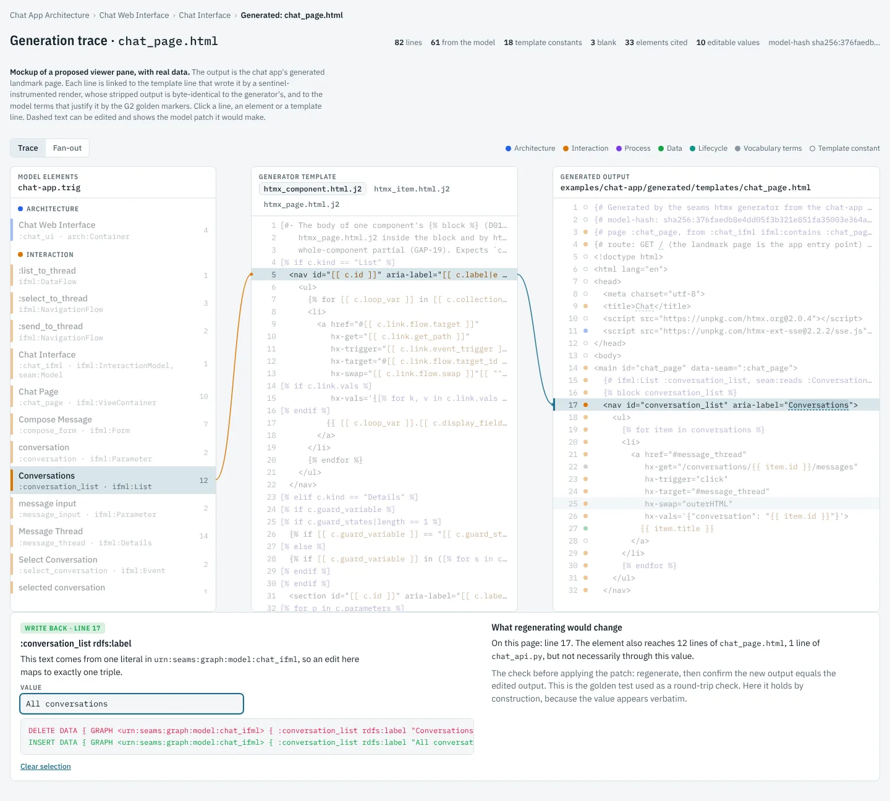

# Research note: tracing generation, and running it backwards

*Status: proposal, 2026-10-31. Not yet scheduled. Linked from the
[backlog](../backlog.md) ("Generator kit and domain IDE" section, items T1 to T5).
Follows the [generator kit and domain IDE note](2026-10-30-domain-ide-and-generator-kit.md)
and the [artifact management note](2026-10-29-artifact-management.md), whose A2 lockfile
it extends. Written against `main` at `752020a`.*

## The question

What do we have for visualising the generation process? Do the books say anything
about it in a domain IDE? Is there a plan to show each generated artifact with lines
from the output back to the model and to the generator that wrote it? And what does
current research say about making the process bidirectional, so that an edit to the
output flows back into the model?

## Short answer

- **We can see where output came from, but only by reading it.** Generated files carry
  comments naming the facts they came from. The golden outputs mark every line with its
  model evidence. Nothing is machine-readable for real output, nothing is drawn, and
  nothing runs backwards.
- **The books barely touch it.** Neither discusses links from generated text back to
  its source.
- **A prototype shows line-level tracing is cheap.** On the chat app's landmark page,
  every non-blank line traced to the template line that wrote it, with no change to the
  output.
- **Value-level tracing needs one discipline first.** About a fifth of template
  expressions compute in the template, and that computation drops the origin. Moving it
  into `extract` fixes this, as the kit note already recommends on other grounds.
- **Bidirectionality should come in tiers, not through a general transformation
  language.** First navigation both ways. Then write-back for values that come from one
  literal. Then structural edits, proposed and checked by regenerating.

*The mockup uses the prototype's real data. Line 17 of the generated `chat_page.html`
is selected. Its trace runs back to `htmx_component.html.j2` line 5 and to
`:conversation_list`, and editing the dashed label shows the one-triple patch it would
make.*

## 1. What exists

- **Comments in generated files.** Every file starts with the generator, the model stem
  and the model hash. The htmx generator also writes a comment above each component
  naming its facts, such as the list it is and the shape it reads. The FastAPI
  generator names what the container exposes. These comments are for people. No tool
  reads them, and they cover sections, not lines.
- **Golden markers.** The hand-written goldens in
  [`docs/generation/golden/`](../generation/golden/README.md) end every line with
  `[graph: <terms>]`, `[fixed]` or `[gap: GAP-NN]`. `tests/test_golden_outputs.py`
  checks that every cited term exists in the model. This is line-level evidence, but
  it exists only for the chat app's three goldens, and the generators strip it.
- **A2 provenance, planned for M012/S02.** The lockfile records, per output file, the
  model elements it came from. That will let a reader click a model element in the
  viewer and list the files it produced. It is file-level.
- **Not planned:** a view of generated artifacts, lines drawn between output, generator
  and model, or anything that runs from output back to model.

## 2. What the books say

Very little.

- **Boersma** (*Building User-Friendly DSLs*) has no mechanism for tracing output back
  to the content that produced it. When generated code carries a flagged placeholder,
  a developer works back to the faulty content by reasoning about it (p. 239). He names
  the fan-out from one detail of the content to many details of the output (p. 229). He
  wants changes verified almost instantly, with tests run inside the IDE (p. 16), and a
  build that can be started from the IDE (p. 201). Of MPS, he notes that templates can
  be written in the target language's own syntax (p. 421), which is where MPS's own
  tracing lives (section 4).
- **Parr** (*Language Implementation Patterns*) mentions only that the C preprocessor
  leaves line-number directives in its output for the compiler (p. 31), which is the
  oldest form of origin tracking. One structural point is useful, though it is our
  inference rather than his claim. He builds an output model before emitting any text
  (pp. 296–297), and our `extract` step does the same. An output object built from an
  input element can carry that element's IRI, and our view objects already do (`c.iri`
  in `seams_gen/htmx.py`).

## 3. A prototype on the chat page

To find out what tracing costs, a throwaway script traced the htmx generator's landmark
page for `examples/chat-app/chat-app.trig`. It made no change to `seams_gen`.

**Method.**

1. Copy the htmx templates, and append a sentinel naming the file and line to every
   template line that emits text. Lines holding only a block tag, and template
   comments, get none, because they emit nothing.
2. Render the real `PageModel` from `extract_page` with the copied templates.
3. Strip the sentinels, and require the result to equal the real generator's output
   byte for byte. This is the check that tracing changed nothing.
4. Read each output line's sentinels as its template origin. An included template
   leaves both its own sentinel and the including line's, so nesting comes for free.
5. Take each output line's model evidence from the golden marker on the same line. The
   output equals the marker-stripped golden, so the lines align.

**Results.**

| Measure | Value |
|---|---|
| Output lines | 82 |
| Traced to a template line | 79, every non-blank line |
| Blank lines | 3 |
| Lines whose evidence cites the model | 61 |
| Template constants (`[fixed]`) | 18 |
| Model elements cited | 33 |
| Values produced by exactly one literal (label, title, path) | 10 |
| Stripped output equal to the generator's | yes |

Across all three goldens, fan-out is easy to see:

- `:MessageShape` reaches 15 lines of the page and 6 of the route module.
- `:chat_api` reaches 4 lines of the route module and 15 of the compose file.
- `:send_message_op` reaches 3 lines of the page and 13 of the route module.

**What the prototype does not show.** The model evidence came from the goldens, which
exist only for the chat app. For any other model, the generator has to record evidence
while it renders. Jinja2's `finalize` hook is the natural place: it sees every value an
expression emits, and a value carrying its origin can leave a sentinel. A quick test
confirmed that a plain value keeps its origin through `finalize`. The same test showed
that escaping, joining, concatenating or lowercasing inside the template drops it. Of
the 213 expressions in `seams_gen/templates/`, 43 do one of those things or carry an
inline condition:

- 19 in `htmx_component.html.j2`;
- 12 in `htmx_task_form.html.j2`;
- 7 in `fastapi_routes.py.j2`;
- 5 in the other templates.

Moving that computation into `extract` is the strict separation Parr argues for
(p. 323) and the kit note recommends for K5. Here it has a second payoff: it makes
value-level origins possible.

## 4. Research

**Trace links from model to text.**

- Olsen and Oldevik (2007) defined trace models between models and generated text, and
  used them to manage change.
- [ChainTracker](https://ualberta.scholaris.ca/items/69765d43-8bfc-4820-b420-52d69401043f)
  traces through chains of transformations, into the generated text, and was evaluated
  with developers.
- The [iTrace thesis](https://ekoizpen-zientifikoa.ehu.eus/documentos/6386b02e50a09d3f4c08831e?lang=en)
  normalises the trace models of different engines into one, and visualises them.

These validate the idea. None is a drop-in for a Jinja2 generator over RDF.

**Origin tracking.**

- [String origins](https://www.informatik.uni-marburg.de/~seba/publications/string-origins.pdf)
  (Inostroza, van der Storm and Erdweg, ICMT 2014) attach an origin to every character
  of generated text. They use it to navigate and to keep protected regions.
- Production tools do the same:
  - Angular emits [source maps](https://github.com/angular/angular/issues/19348) from
    generated files back to templates.
  - MPS writes `trace.info` files during its final text stage and offers a `$TRACE$`
    macro for nodes it cannot trace automatically
    ([MPS debugger documentation](https://jetbrains.com/help/mps/debugger.html)).

Our sentinel render is this technique at line granularity.

**Bidirectional transformations.**

- Lenses, triple graph grammars and QVT-R all specify a transformation once and run it
  both ways. A QVT-R case study on keeping UML and Java in sync notes that bidirectional
  transformations are still rarely used in model-driven practice
  ([IEEE](https://ieeexplore.ieee.org/document/7954342/)).
- A [survey of transformation tools](https://research.cs.queensu.ca/home/cordy/Papers/KBCDV_SoSyM18_MTSurvey.pdf)
  found round-trip support in about 15% of them.
- The closest industrial precedent is
  [CHAMELEON](https://arxiv.org/abs/2305.03361) at OutSystems (2023). It keeps
  domain-specific UI builders consistent with the underlying low-code model through a
  lens-like view and synthesis mapping, built from component patterns. Its worst case is
  92 ms on whole models, fast enough for live editing. Its scope is the UI part of the
  language, which is also where our forms-from-shapes layer (I2) sits.

**Editing the output directly.**

- [Bidirectional evaluation](https://arxiv.org/pdf/1809.04209) in
  [Sketch-n-Sketch](https://ravichugh.github.io/sketch-n-sketch/) runs a program in
  reverse, so an edit to generated HTML or SVG becomes a small program change.
- [FuseDM](https://doi.org/10.1145/3632883) (POPL 2024) merges direct manipulations into
  the program. It guarantees the new program produces exactly the edited output, without
  the user tracking links.
- A [2024 ETH course module](https://github.com/AlexLike/ETH-UCPI24/blob/main/topics/w5-direct-manipulation.md)
  judges truly bidirectional programming to be still many papers away.

These systems invert a general-purpose program. We do not have to: our generators are
mostly lookups of graph facts, and the trace already says which fact a value came from.

**LLMs.**

- A [2026 round-trip benchmark](https://www.sciencedirect.com/science/article/pii/S0164121226002475)
  found LLMs carry small, routine edits between coupled artifacts reliably, but fail
  when the edit needs structural reorganisation.
- Recent preprints keep a natural-language spec in sync with code, with a person
  approving each spec edit before it reaches code
  ([PROOF](https://arxiv.org/html/2609.06383)). Their venues are not yet confirmed.

The lesson for us: an LLM can propose a model patch, but something mechanical must
accept or reject it.

**Classic round-trip engineering.** It fails when hand edits to generated code are
overwritten on the next generation.
[Sync regions](https://dl.acm.org/doi/pdf/10.1145/3550356.3561578) copy hand-edited code
back into the model. Our answer is to keep hand-written code out of generated files
(U6), so there is nothing to copy back.

## 5. Proposal

### 5.1 Trace capture

Generators record, for every output span:

- the template file and line that emitted it (the prototype's sentinels);
- the model terms behind it, using the golden marker vocabulary.

The trace is written as a sidecar file next to each output, and stripped from the output
itself. The output stays byte-identical, so the golden and freshness tests are
unchanged. A2's per-file source elements become a summary of the traces rather than a
separate computation.

The model terms come from origin-carrying values in the view model, emitted through
Jinja2's `finalize`. That needs the 43 lossy expressions moved into `extract`. Until
they are, those spans fall back to line-level evidence: the elements behind the
enclosing view object.

The golden markers then gain a second use. Today they say what each line *should* cite.
A test can compare them with what the generator *did* cite, and catch evidence drift
the byte comparison cannot see.

### 5.2 A generation view in the viewer

This is the mockup above.

- **Three panes.** Model elements grouped by layer in the viewer's layer colours, the
  generator template, and the output. Lines are drawn between them. Selecting an output
  line shows its template line and its elements. Selecting an element shows every line
  it reaches. Selecting a template line inside a loop shows every line it emitted.
- **A fan-out view.** One bar per element, split by output file.
- **A way in from the existing viewer.** The element inspector gains a "Generated"
  section listing the files and lines an element reaches, linking into this view.

### 5.3 Bidirectional, in tiers

1. **Navigate both ways.** Free once traces exist.
2. **Write back single-literal values.** A span whose origin is one literal can be
   edited in place. In the prototype, 10 of the page's values qualify, such as a label,
   a page title or a path. The edit becomes a one-triple patch in the right named
   graph. Before applying it, regenerate and require the new output to equal the edited
   output. That is the golden test reused as a round-trip check, and it is the property
   FuseDM guarantees by construction. Some literals have effects beyond the page: a
   lifecycle state's label is also read by the runtime. The write-back has to show
   those effects before applying, using the same traces.
3. **Propose structural edits.** An edit to a line that no single literal produces, such
   as a new form field, becomes a proposed model patch. A person, a rule or an LLM can
   draft it. It is accepted only if regenerating reproduces the edit, and the person
   reviews the patch, not the output. The benchmark above suggests this works for small
   edits and fails for reorganisations, so it should start narrow.
4. **What stays out.**
   - Hand-written code lives outside generated files (U6), so it never needs
     round-tripping.
   - BPMN and DMN are already bidirectional, because the native XML is the source and a
     modeler edits it directly (I4).
   - No general bidirectional transformation language. Its cost is a second way of
     writing every generator, and tiers 1 to 3 cover the edits a domain expert makes.

## Backlog items

| # | Item | Builds on |
|---|---|---|
| T1 | **Trace capture**: template origins by sentinel render, model origins through `finalize` with origin-carrying values, a sidecar trace per output, A2 provenance derived from it, and a test comparing traces with golden markers | K3; A2 for storage |
| T2 | **Logic out of templates**: move the 43 filtered, concatenated or conditional expressions into `extract`, with goldens unchanged. This is also K5's recommendation | none |
| T3 | **Generation view**: the three linked panes, the fan-out view, and a "Generated" section in the element inspector | T1 |
| T4 | **Write-back of single-literal values**: edit in place, one-triple patch, regenerate-and-compare before applying, and effects beyond the page shown first | T1, I1 |
| T5 | **Structural edit proposals**: drafted patches accepted only when regeneration reproduces the edit; start with adding and removing form fields | T4 |

T2 stands alone and can be done first; it also makes the templates easier to read. T1
and T3 do not depend on the editing items, so the generation view can ship while
editing stays a v1 non-goal. T4 and T5 belong with the IDE items.

## Open questions

- **Granularity.** Line-level traces are robust and cheap. Value-level traces need T2.
  Is line level enough for the first version of the view?
- **Where traces live.** Sidecar files beside each output, one file per generator run,
  or the A2 lockfile itself?
- **Other generators.** The compose and FastAPI templates are line-based like the htmx
  ones, so the sentinel method should carry over. That has not yet been tried.
- **Formatting.** If a formatter ever runs over generated code, traces need remapping
  or the formatter has to run before tracing. Today no formatter runs.
