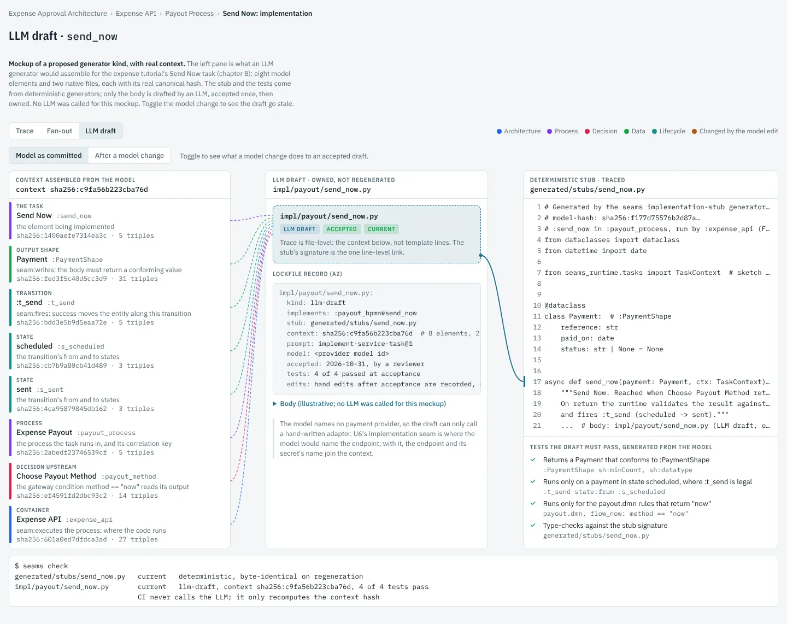
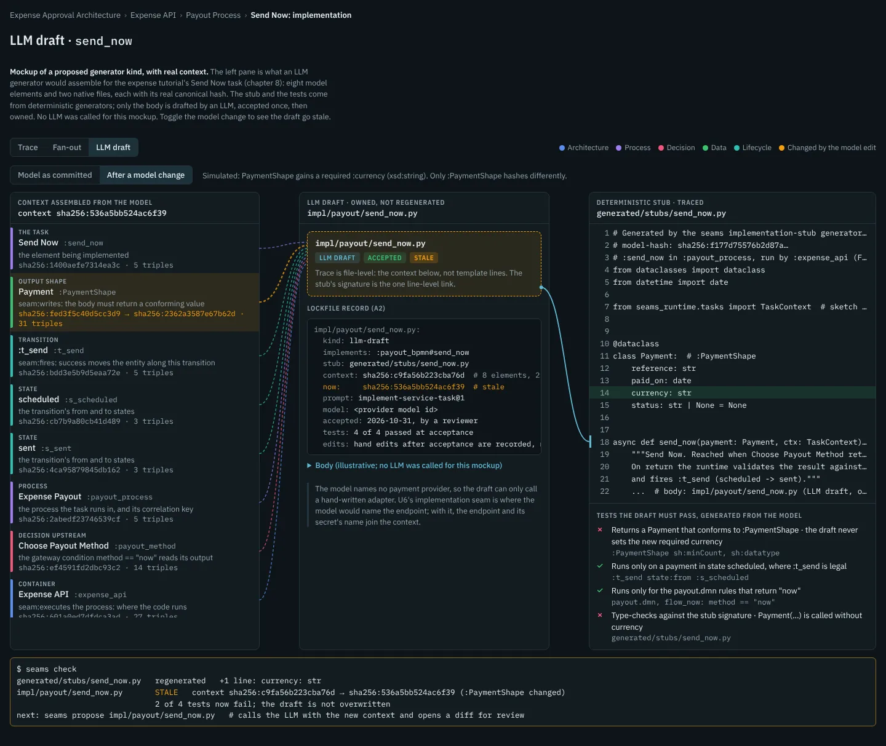

# Research note: an LLM generator for the code templates cannot write

*Status: proposal, 2026-10-31. Not yet scheduled. Linked from the
[backlog](../backlog.md) ("Generator kit and domain IDE" section, items C1 to C5).
Builds on the [generation trace note](2026-10-31-generation-trace.md) (T1 to T5), the
[generator kit note](2026-10-30-domain-ide-and-generator-kit.md) (K3) and backlog item U6.
Written against `main` at `752020a`.*

## The question

Template generators can write compose files, FastAPI route modules and htmx pages,
but can they write all the code an application needs? If not, can we have a generator
whose job is to call an LLM with a chosen context and save the code it writes, and can
that output be traced back to the model like everything else?

## Short answer

- **No, templates cannot write all the code, and they should not try.** They do well
  where code follows from structure. Process and decision logic is already interpreted
  at run time (ADR-0007), not generated. What is left is the body of a task that talks
  to the outside world, and that is where the gap is.
- **Yes to an LLM generator, if it differs from the deterministic ones in three ways:**
  - it writes only into the hand-written-code location U6 will define, behind a
    deterministic stub;
  - its output is accepted once and then owned, never regenerated in CI;
  - its trace is the model context it was given, at file level, not template lines.
- **The model can check the result.** The same model that supplies the context also
  generates the tests a draft must pass before anyone accepts it.

*The mockup's third view, with real context from the expense tutorial. Left: the
eight model elements and two native files an LLM generator would send, each with its
canonical hash. Middle: the draft file, traced to that context at file level. Right:
the deterministic stub, whose signature is the one line-level link, and the four tests
generated from the model.*

## 1. What templates cannot write, and where it should live

The generators cover the structural code: routes, forms, partials and compose
services. The interpreted engine covers the behavioural logic: BPMN flow, DMN
decisions and lifecycle transitions. What neither covers is a service task whose work
happens outside the model, such as sending a payment, an email or a call to a partner
API.

The [UML coverage note](2026-10-29-uml-coverage-and-gaps.md) (section 3.3) calls this
the expressiveness cliff. Backlog item **U6** (M014) answers it with two things:

- one seam from an operation to the code or external endpoint that implements it;
- a rule for where hand-written code lives, so regeneration never overwrites it.

Boersma (*Building User-Friendly DSLs*) divides a runtime's code into three kinds
(pp. 199–200, revisited p. 280):

- code generated from the model;
- hand-written code that generated code calls or is called by;
- everything else.

An LLM generator writes the second kind. In this note it writes into U6's location,
not beside the generated files.

Two existing pieces are easy to confuse with this:

- **`seams_runtime/llm.py`** calls an LLM while the app runs, to stream the chat app's
  completions. That is application behaviour. This note is about calling an LLM when
  the code is built, to write code.
- **Boersma's two uses of an LLM** (p. 231). One drafts a *template* from example
  content; the other generates *code* directly from descriptions of what it should do.
  He treats either result as a half-finished product, to be validated with tests,
  refactored and documented before it is trusted. This note takes the second use and
  supplies the tests from the model.

## 2. A worked example: Send Now

In the expense tutorial's final chapter
(`examples/expenses/chapter-08/expenses.trig`), the payout process has a service task
**Send Now**. The model says the task:

- writes a `:PaymentShape`;
- fires `:t_send`, which moves the payment from *scheduled* to *sent*;
- is reached when the `:payout_method` decision returns `"now"`, through the gateway
  condition `method == "now"` in `payout.bpmn`;
- runs in `:expense_api`, which `seam:executes` the payout process.

Today the runtime stores the payment and fires the transition, but nothing sends
money. The model names no payment provider at all.

A throwaway script assembled the context an LLM generator would send for this task.
It made no change to the repository. Each element is hashed as its concise bounded
description, canonicalised with rdflib so that blank-node labels do not matter. Each
native file is hashed as bytes.

| Element | Role | Triples | Hash |
|---|---|---|---|
| `:payout_bpmn#send_now` | the task | 5 | `sha256:1400aefe7314ea3c` |
| `:PaymentShape` | output shape | 31 | `sha256:fed3f5c40d5cc3d9` |
| `:t_send` | transition | 5 | `sha256:bdd3e5b9d5eaa72e` |
| `:s_scheduled`, `:s_sent` | its states | 3 each | `sha256:cb7b9a80…`, `sha256:4ca95879…` |
| `:payout_process` | process and correlation key | 5 | `sha256:2abedf23746539cf` |
| `:payout_method` | decision upstream | 14 | `sha256:ef4591fd2dbc93c2` |
| `:expense_api` | container that runs it | 27 | `sha256:601a0ed7dfdca3ad` |
| `payout.bpmn` | flow around the task | file | `sha256:19b0e07de310d914` |
| `payout.dmn` | rules that choose "now" | file | `sha256:600f569167f644b9` |

The context hash over all of them is `sha256:c9fa56b223cba76d`.

**A model change.** The script then added a required `:currency` property to
`:PaymentShape`. Exactly one element hash changed, the shape's, and the context hash
became `sha256:536a5bb524ac6f39`. The draft is now stale for a real reason: it never
sets a currency. Two of the four generated tests (shape conformance and the type
check) would fail against it. The mockup's "After a model change" toggle shows this
state.

**A finding about context precision.** The container's 27 triples include every
operation it exposes. Hashed whole, adding an unrelated operation to `:expense_api`
would mark this draft stale. Context assembly has to keep only the facts the task
uses: here, the container's technology and its deployment bindings, not its full
description. The same applies to any element with many unrelated edges.

## 3. Design

### 3.1 Contract first

Before any LLM call, deterministic generators write two things.

- **A stub**, under `generated/`, traced like any other output (T1):
  - a data class for each shape the task reads or writes, from `sh:path`, `sh:datatype`
    and `sh:minCount`;
  - the function signature;
  - a docstring naming the decision that leads to the task and the transition its
    success fires.

  For Send Now, `Payment` has `reference: str`, `paid_on: date` and
  `status: str | None`.
- **The acceptance tests**, generated from the model:
  - the returned value conforms to the written shape (U5's SHACL examples, A9's
    response checks);
  - the task runs only in the transition's *from* state;
  - the task runs only for the DMN rules that lead to it (U5's decision scenarios);
  - the draft type-checks against the stub.

The LLM writes only the body, in the U6 location (`impl/payout/send_now.py` in the
mockup). A draft is accepted only if every test passes.

### 3.2 Context assembly

Context is built by rules, per kind of element, from the `seams` library's views. The
rules for a service task:

- **The task**, and what it reads, writes and fires.
- **The shapes**, down to their property shapes.
- **The transition**, with its from and to states.
- **The process**, and its correlation key.
- **The decision** whose output the incoming gateway condition reads.
- **The container**, narrowed to its technology and bindings. Bindings are named only,
  never with their values.
- **The native BPMN and DMN files.**
- **The stub and the tests**, so the LLM sees the contract it must meet.

Model text such as labels and comments goes into the prompt as data, quoted, never as
instructions.

The manifest records each item's IRI and hash, and the hash over all of them is the
draft's context hash. This manifest is the trace: model element → draft file, at file
level. The stub's signature is the only line-level link, and it comes from the
deterministic side.

### 3.3 Accept once, then own

| State | Means |
|---|---|
| Proposed | An LLM wrote a draft; it waits for review |
| Accepted | Its tests passed and a person accepted it. The file is now owned like hand-written code |
| Current | The model context still hashes the same as at acceptance |
| Stale | The context hash changed. `seams check` (A1) reports it; nothing is overwritten |
| Re-proposed | A new draft from the new context, offered as a diff against the accepted file |

- **CI never calls the LLM.** It recomputes the context hash, compares it with the
  lockfile, and runs the tests. That keeps CI deterministic, free of API keys, and
  cheap.
- **Hand edits after acceptance are recorded, not reverted.** The lockfile stores the
  file's hash at acceptance, so the view can say "edited since acceptance". A
  re-proposal is then a three-way merge, not an overwrite. That avoids the classic
  failure of round-trip engineering, where regeneration destroys manual changes.

### 3.4 Provenance

An `llm-draft` entry in the A2 lockfile records:

- the file it describes and what it implements;
- the stub it implements;
- the context hash, with the manifest;
- the prompt template's name and version;
- the model provider's identifier;
- the acceptance date and the reviewer;
- the test results at acceptance;
- the file's hash at acceptance.

That is enough to answer "why does this code exist, what was it told, and is it still
true?"

### 3.5 In the generation view

The mockup at [`mockups/generation-trace.html`](mockups/generation-trace.html) gains
an **LLM draft** view. The same view is in the Claude artifact
(<https://claude.ai/artifact/4YYa63dU5ArmTiED4FeypE>), which is private until shared.
It shows the context items on the left, each joined to the draft by a dashed line in
its layer's colour. The draft sits in the middle with its state and lockfile record.
The stub and the tests are on the right, with a solid line from the stub's signature.

Selecting a context item highlights the stub lines it produced. The model-change
toggle recolours the changed item, marks the draft stale, adds the new field to the
stub, fails the two affected tests, and shows what `seams check` would print.

### 3.6 Safety

- **Prompt injection.** Model text reaches the prompt only as quoted data.
- **Secrets.** The context names deployment bindings, never their values.
- **Network.** The generator runs where the environment's network policy allows. It is
  never run in CI.
- **Review.** Nothing is accepted without passing tests and a person's acceptance.
  Generated code runs inside the application, so it is reviewed like any contribution.

## 4. What the research says

- **Boersma** (p. 231) treats LLM-generated code as a half-finished product needing
  tests, refactoring and documentation. The design above supplies the tests from the
  model.
- A [2026 change-aware round-trip benchmark](https://www.sciencedirect.com/science/article/pii/S0164121226002475)
  found that LLMs propagate small, routine edits reliably but fail when an edit needs
  structural reorganisation. A service-task body behind a fixed stub is the small,
  bounded case. Re-proposals after large model changes need more scrutiny.
- [PROOF](https://arxiv.org/html/2609.06383), a recent preprint whose venue is not yet
  confirmed, keeps a natural-language spec layer in sync with code, with a person
  approving each spec edit before it reaches code. It is the same pattern as here: the
  LLM proposes, something checkable decides, and a person accepts.
- [Round-trip work on code embedded in models](https://dl.acm.org/doi/pdf/10.1145/3550356.3561578)
  copies hand edits back into the model through sync regions. Keeping drafts in their
  own files, linked by context rather than merged into generated files, avoids needing
  that.

## Backlog items

| # | Item | Builds on |
|---|---|---|
| C1 | **Implementation stub generator**: per service task, a deterministic, traced stub with data classes from the read and written shapes, the signature, and a docstring naming the decision and transition | U6 (ADR first), T1 |
| C2 | **Acceptance tests from the model**: shape conformance, legal-transition state, decision-branch scenarios, and a type check against the stub | U5, A9, C1 |
| C3 | **Context assembly**: per-kind rules, narrowed to the facts used, canonical hashing of each element and native file, and a manifest with a context hash. Can be built now as a report | `seams` library |
| C4 | **LLM draft generator**: provider-agnostic call, versioned prompt templates, writes only to the U6 location, `seams propose`, accepted only when C2's tests pass, with the safety rules in section 3.6 | C1–C3, K3, U6 |
| C5 | **Drafts in the lockfile, `seams check` and the generation view**: an `llm-draft` record, staleness from the context hash, hand-edit detection, and the draft node in T3 | A1, A2, T3, C3 |

C3 needs nothing new and can show, for any task, what an LLM would be told, which is
useful for review even without an LLM. C1 and C2 are useful without an LLM too: a
person writing the body by hand gets the same stub and the same tests. C4 is the only
item that calls a model.

## Open questions

- **Which tasks?** Service tasks are the obvious start. Adapters for external APIs,
  once U6 lets the model name an endpoint, and data migrations from U8's shape diff,
  are the next candidates.
- **Providers and determinism.** Should drafts pin a provider and model, cache the
  response with the context hash, or allow any provider? Pinning helps reproducibility;
  caching makes a re-run of the same context free.
- **A generator that writes generators.** Boersma's other LLM use drafts a *template*
  from example content (p. 231). With K5's scaffold, a reference output and a golden
  test, an LLM could propose a new deterministic generator, accepted only when the
  golden test passes. That is a step up from drafting code: the result is a reusable
  generator rather than a single file. The
  [data-centric note](2026-10-31-data-centric-model-and-copilot.md) takes this up as R3,
  alongside a model copilot (R1, R2).
