# Research note: a product review from the modelling side, and ten UI ideas

*Status: review, 2026-11-03. Not yet scheduled, and nothing here is in the
[backlog](../backlog.md) yet; the candidate rows are listed at the end. Written against
`main` at `50cddfa`, after M020 landed. It reads the README, the
[product brief](../../orig_convo/product-brief.md), the [principles](../project/principles.md),
the nineteen ADRs, the backlog and the research notes of October and November 2026, and it
runs the viewer in edit mode on the expense tutorial's chapter 9 model. The persona is a
product designer who comes from model-based systems engineering (MBSE) tooling rather than
from application development.*

## The questions

What has the project built, measured as a modelling product? What would an application
builder or an architect still miss? How useful is it now, how useful could it be, and
which interface ideas would close the gap?

## Short answer

- **An unusually rigorous proof of concept with a complete vertical slice.** Its weakest
  part is the thing a product designer cares about most, the authoring experience. The
  engine is ahead of the dashboard.
- **The digital thread is real.** One graph drives forms, routes, compose files,
  Dockerfiles, derived tests, smoke tests and sequence diagrams, with a line-level trace
  from every generated line back to the model and a lock that reaches the running
  container. Few MBSE tools do model-to-deployed-artifact traceability this tightly.
- **The viewer does not yet meet the brief's own "RDF invisibility" principle**, two of
  its canvases render as thumbnails on first load, and the flagship example ships with
  21 of the project's own review warnings.
- **Today** an RDF-literate developer can build a workflow application from one file and
  get a map, tests and a compose stack for free. A developer who will not write TriG
  cannot use it yet.
- **The strongest pitch is half noticed.** When language models write most code, the
  model is the specification that constrains them and the oracle that tests their output.
  Framed that way the product is the governed context layer for agentic coding, and the
  trust machinery already built is exactly what that needs.
- **Ten UI ideas** follow, each with a mockup. The one bet: do the first two, an
  event-storm board as the blank page and sentence editing instead of IRI boxes, before
  any further generator or vocabulary work.

## 1. Where it stands

### What is built, in MBSE terms

| Capability | What exists | Why it matters to this persona |
|---|---|---|
| Digital thread | Generators, `<output>.trace.json` sidecars ([ADR-0019](../adr/0019-generation-trace.md)), `seams.lock`, `seams status`, the model hash in `/healthz`, the viewer's generation view | Model-to-artifact-to-deployment traceability, which MBSE promises and rarely delivers |
| Interpret behaviour, generate structure | BPMN and DMN execute natively in SpiffWorkflow ([ADR-0007](../adr/0007-execution-strategy.md)) | A rule change does not regenerate code, so "the model is the source of truth" holds |
| Trust machinery | Shape-generator parity, byte determinism, goldens, coverage queries, `seams diff` and `seams plan`, 2,194 tests | The checks an architect would otherwise do by review |
| Derived views | Sequence diagrams, the layers stack, the planned storm board, all projections of the graph | SysML v2's view-and-viewpoint idea, by construction; no authored diagram can drift |
| Editing | One write path ([ADR-0017](../adr/0017-write-path-and-editor.md)), forms from shapes, the bpmn.io modelers with id renames, IFML on diagram-js, a live preview, domain profiles ([ADR-0018](../adr/0018-domain-profiles.md)) | The write side exists; the question is how it feels |

### What the viewer shows

These are observations from running the viewer on
`examples/expenses/chapter-09/expenses.trig` with `SEAMS_EDIT=1`, at 1440 by 900 pixels.
They matter because the product brief names *RDF invisibility* as a design principle:
users never see Turtle, IRIs or vocabulary names.

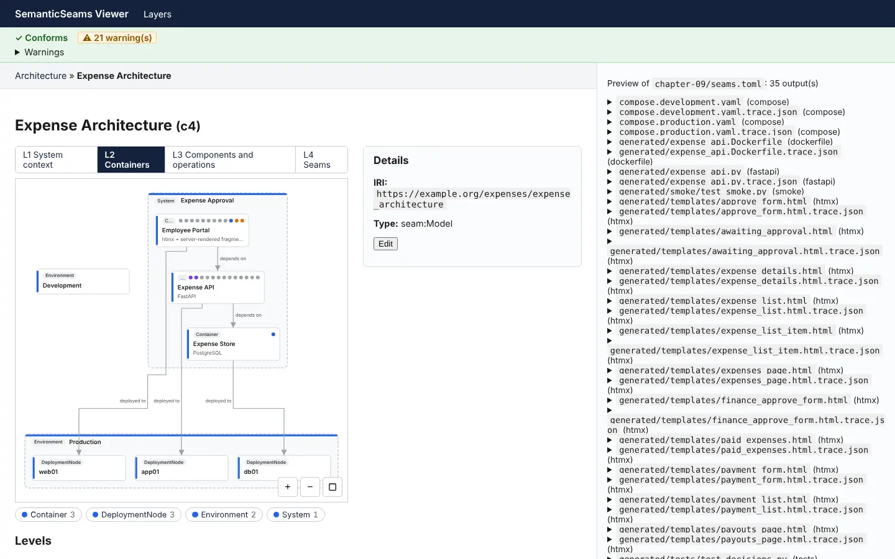

*The architecture view is the strongest renderer: nesting, seam dots coloured by target
layer, levels as tabs. The inspector leads with the IRI, and the preview pane lists 35
filenames.*

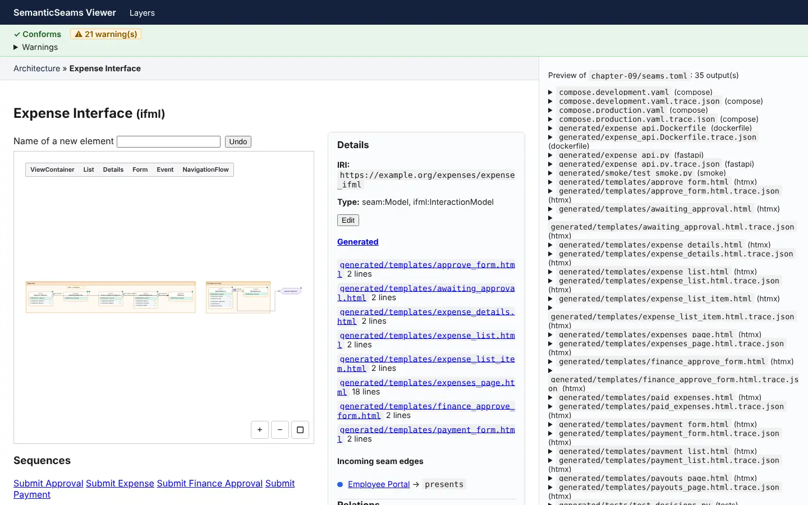

*The IFML view on first load. The diagram is a strip a few pixels tall until the user
finds the fit button.*

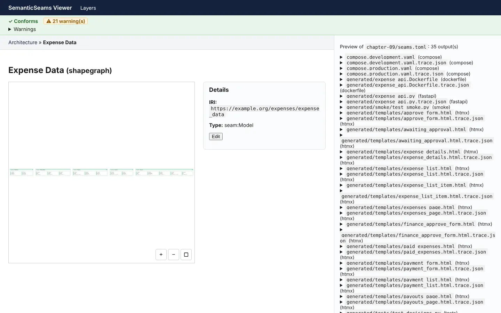

*The data layer, which the brief calls the data contract, is effectively invisible on
first load.*

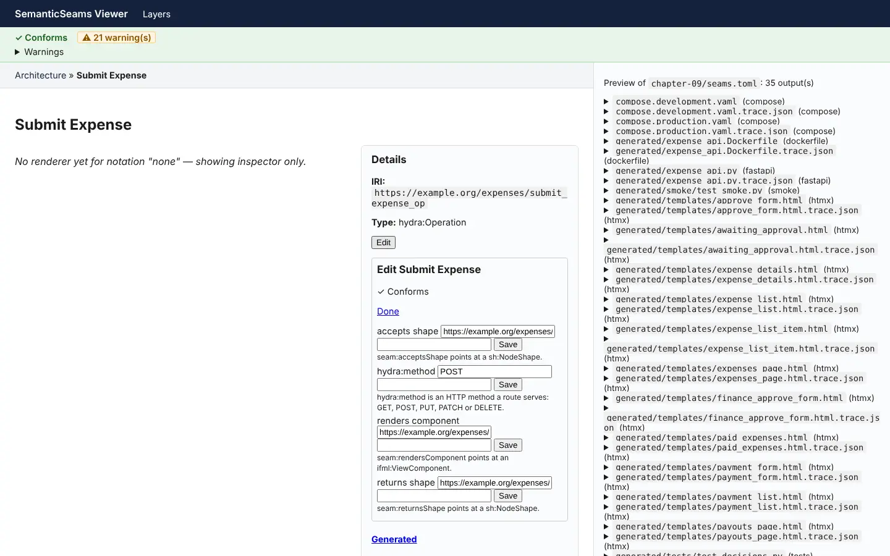

*Edit mode for an operation: four text boxes of full IRIs, with helper text such as
"seam:acceptsShape points at a sh:NodeShape".*

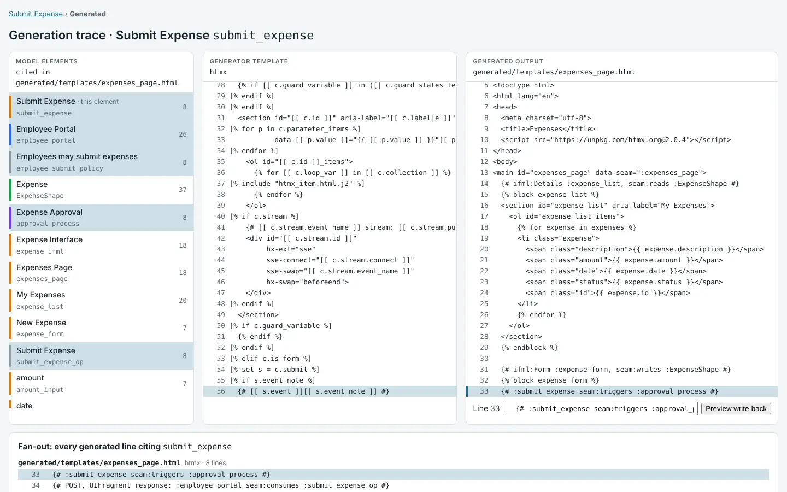

*The generation view is the best screen in the product. Model, template and output are
joined line by line, with fan-out and a write-back preview.*

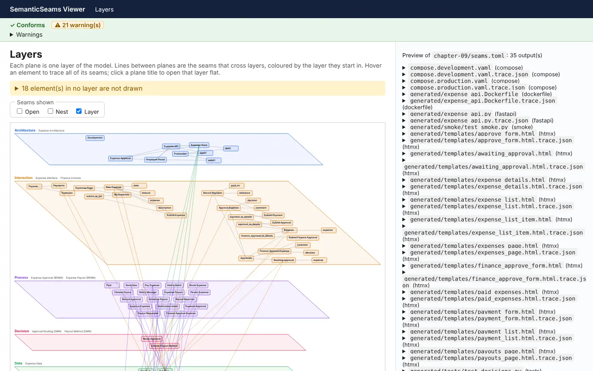

*The layers stack is the memorable overview. At expense-app size the seam lines already
read as spaghetti, and it warns that 18 elements are drawn nowhere.*

What undercuts the principle:

- **RDF invisibility is not met.** Type pills say `hydra:Operation`, the inspector leads
  with the IRI, and the edit forms are IRI text boxes.
- **Two canvases render as thumbnails.** IFML and the shape graph need a manual fit before
  anything is readable.
- **The preview pane is a file list.** The persona wants to see the generated screen, not
  its path.
- **The flagship example ships with 21 warnings.** All come from R1's review checks:
  shapes without a target class, status lists copied from lifecycles, undeclared
  properties. The checks are right. Shipping the tutorial red against them says the data
  layer is half designed, which O1 and O2 already know.
- **No search.** Past twenty elements, navigation is click or nothing.

Small drift worth fixing: the README says 28 seam predicates, the outline says 25, and
`ontology/seam.ttl` declares 34. The reveal-modes note promised animated transitions
between Open, Nest and Layer; Open and Layer exist as separate pages. A direct hit on the
questions endpoint returns raw JSON, which is fine for an API and confusing from a link.

## 2. What is missing

Measured against what an MBSE practitioner expects, grouped by who it blocks. The brief
names two personas: the solo builder now, the enterprise moderniser later.

| Gap | Who it blocks | Status |
|---|---|---|
| An authoring front door that is not TriG: project templates, a blank-project wizard, import from OpenAPI, SQL, existing BPMN or compose files | Everyone on day one | Import is a v1 non-goal |
| Labels over IRIs everywhere, pickers instead of IRI text boxes | Everyone | No row |
| Requirements with satisfaction and verification links, and a traceability matrix | Enterprise; also the tutorial's "why does this element exist" | Named in the [UML note](2026-10-29-uml-coverage-and-gaps.md), no row |
| Domain ontology: classes, declared properties, states as IRIs. The root of the 21 warnings | Both | O1, O2 in M023 |
| Vocabulary versioning and model migration | Anyone with a model older than a month | K6 in M023 |
| Variants and configurations: one model, several products | Enterprise | Nowhere |
| Multi-user editing, locking and in-tool review | Enterprise | Explicit non-goal |
| Timers and scheduled work | Most real applications | U10, proposed |
| More than one replica | Any production deploy | A10, proposed |
| Non-functional requirements, data classification, external systems | Enterprise reviews | One line each in the UML note |
| Observed behaviour fed back into the model: an as-observed graph, live instance counts | Both, once something runs | Later work after M013 |
| Global search and a command palette | Everyone past twenty elements | Nowhere |

The generated application is also narrow by design: server-rendered htmx with lists,
details and forms, Python handlers, header-based identity and one serving container. That
covers internal tools and workflow applications well. It does not cover rich interfaces,
file uploads, multi-tenant authentication or mobile.

## 3. How useful it is

**Today.** A developer who reads RDF and wants a workflow application with human tasks,
decision tables, lifecycles and role policies can build one from a single file. They get
a clickable map, derived tests and a compose stack for free. That is real, and it is more
than most model-driven tools deliver. A developer who will not write TriG cannot use it
yet. Edit mode exists but does not change that: it edits facts one IRI at a time, and it
cannot start a model from nothing.

**What it could reach.** The [LLM generator note](2026-10-31-llm-generator.md) already
describes context assembly, model-derived acceptance tests and accept-once ownership.
Taken together with the thread, that is the product: the model is the specification that
constrains a language model and the oracle that tests its output. SemanticSeams is then
not competing with BESSER or WebRatio. It is the governed context layer for agentic
coding, with the digital thread that MBSE tools promise and application developers have
never had.

## 4. Ten UI ideas for the gaps

Ordered by leverage. The first three get people in; the rest make the thread visible.
Each mockup is drawn in the viewer's own chrome and layer colours with the expense
tutorial's real element names. Counts, instance numbers and run ids are illustrative. The
sources are in [`mockups/ui-ideas/`](mockups/ui-ideas/), one HTML file per idea over a
shared stylesheet, rendered at 1200 by 720.

### 4.1 Event-storm board as the blank page

Fills: the authoring front door, and import for workshop output.

The [DDD note](2026-11-02-domain-driven-design.md) proposes deriving the storm view (B4)
and warns against authoring it. Go one step further: make the coloured-sticky board the
capture surface for someone who will never write TriG, with the derived storm as the
round-trip acceptance test. An orange sticky creates a transition, blue a POST operation,
yellow a shape with a lifecycle, purple a decision. The board becomes the import path for
workshop output and the first thing a new user touches.

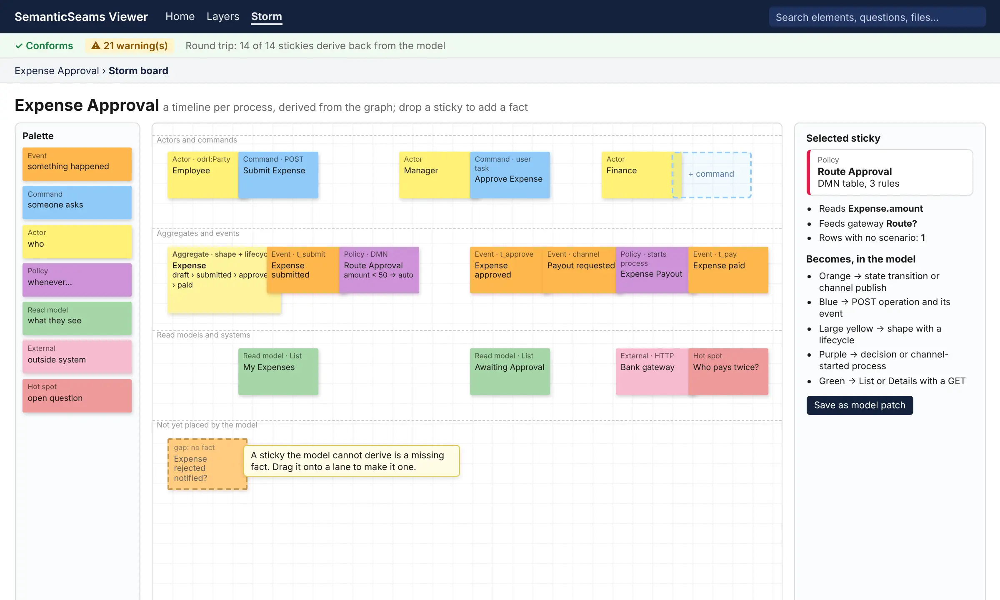

*Lanes carry the expense process as stickies derived from the graph. A dashed sticky in
the bottom lane is one the model cannot derive, which makes it a missing fact to drag into
place. The health bar reports the round trip.*

### 4.2 Sentence editing instead of IRI boxes

Fills: RDF invisibility, and edit-mode usability.

Edit a seam as a typed sentence: "Submit Expense submits to [pick an operation] which
accepts [pick a shape] and triggers [pick a process]." Each slot is a picker filtered by
the predicate's shape, and a missing slot is a placeholder that invites input. This is
Boersma's projectional editing ([kit note](2026-10-30-domain-ide-and-generator-kit.md),
section 4) applied to the seams only, and it is what makes the invisibility principle
true.

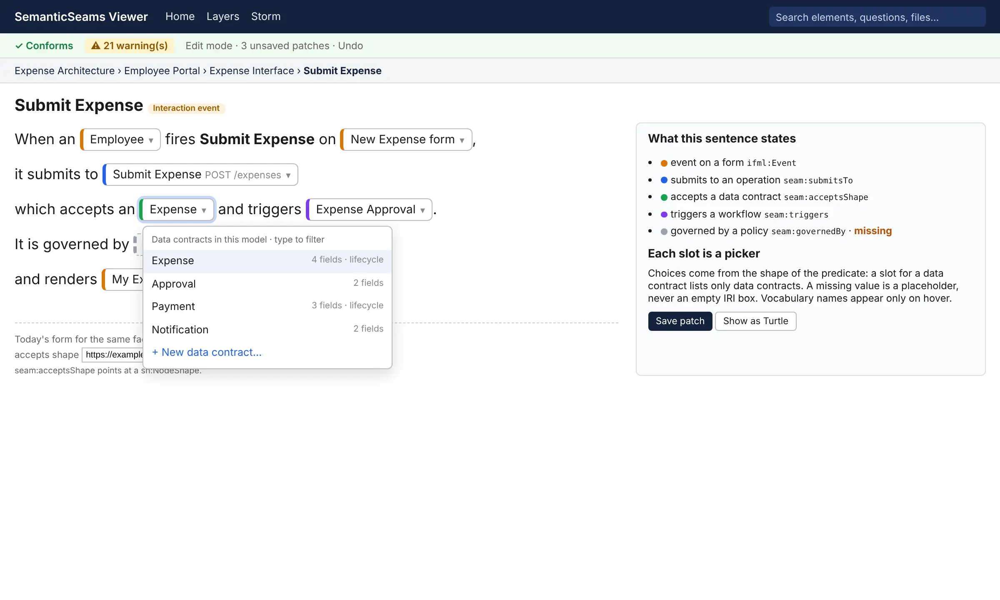

*One sentence states five seams. The open slot lists only data contracts. The missing
policy is a placeholder with a warning, and the current IRI text box is shown underneath
for contrast.*

### 4.3 Questions as the home page

Fills: the buried cross-layer queries, and governance at a glance.

The canned queries are the product's best argument and they sit under each diagram. Make
the landing page a model cockpit: one card per question with a live count, red when a gate
fails, plus the breaking-change count against the main branch. An architect opens the
model and reads "2 ungoverned writes, 3 unfired transitions, 1 breaking contract change"
before any diagram.

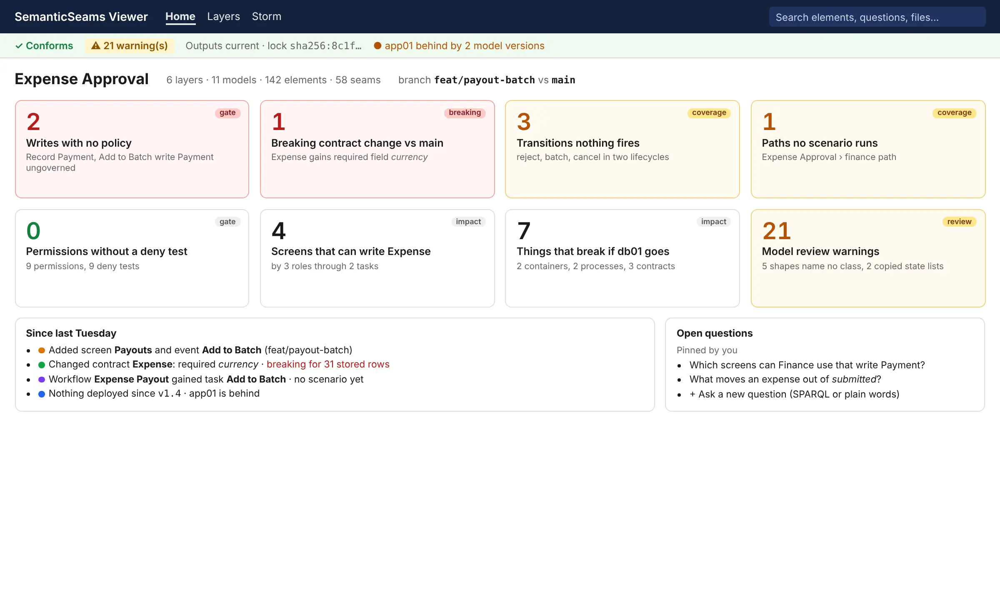

*Every card is one of the existing canned queries or coverage gates. Red cards fail a
gate, amber cards are coverage gaps, and the bottom row narrates what changed on the
branch.*

### 4.4 The thread strip

Fills: traceability as a constant rather than a page.

A persistent bottom ribbon for the selected element showing the whole chain as chips:
model, shape status, generated outputs, lock state, deployed version, scenarios that cover
it, last trace. The generation view already joins three of those panes. Generalising it
makes the digital thread the viewer's resting state.

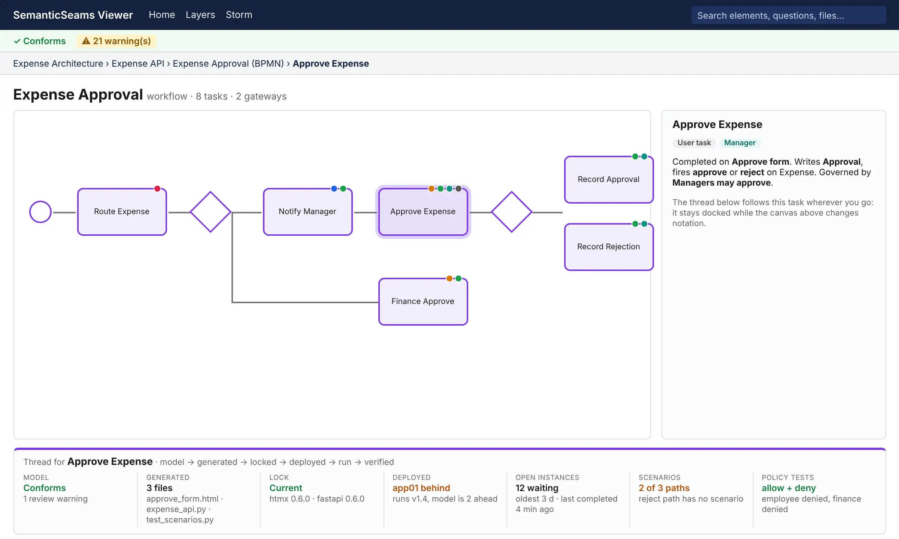

*The strip stays docked while the canvas above changes notation. Each chip is a status
with a one-line reason, and each opens the page behind it.*

### 4.5 Role lens

Fills: the authorization pillar, and compliance review.

Pick a party and every view dims what that role cannot reach: screens, events, writes,
tasks. This is `screens-by-role-writing-shape.rq` drawn as a filter. It costs little and
it is the most legible demonstration of why authorization is a pillar.

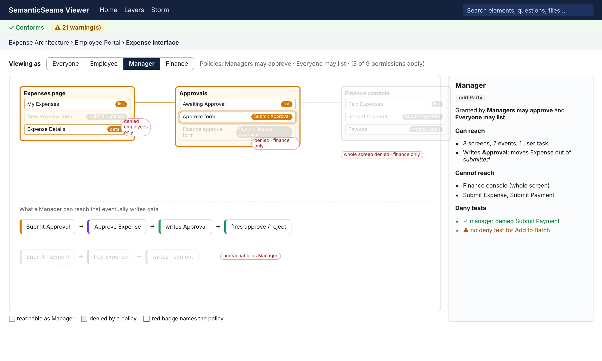

*Switching the role dims what its policies deny and names the policy on a badge. Below
the screens, the compliance query is drawn as the write paths the role can reach.*

### 4.6 Scenario player

Fills: simulation, and as-designed versus as-executed.

Pick a `verify:` scenario and step it: the derived sequence diagram advances, the DMN row
that fired highlights, the statechart animates the transition, payloads show per arrow.
MBSE audiences expect simulation, and the pieces exist in `seams sequence` (U1), its
`--trace` mode (U4) and the scenario vocabulary (U5). Overlaying a recorded trace on the
same player gives as-designed versus as-executed in one control.

*Step five of the manager-approved scenario. The decision table shows the row that hit,
the lifecycle shows the current state, and the comparison panel reports where the
recorded run disagreed with the model.*

### 4.7 Diff on canvas

Fills: model review, and merge.

For a pull request, draw the named-graph diff in each notation: added elements green,
removed red, changed seams dashed, with the `seams plan` output as the narrative beside
it. Model merge is where commercial MBSE tools are weakest. Here git plus a deterministic
writer makes it cheap. The [UML note](2026-10-29-uml-coverage-and-gaps.md) names this view
in passing; this is what it looks like.

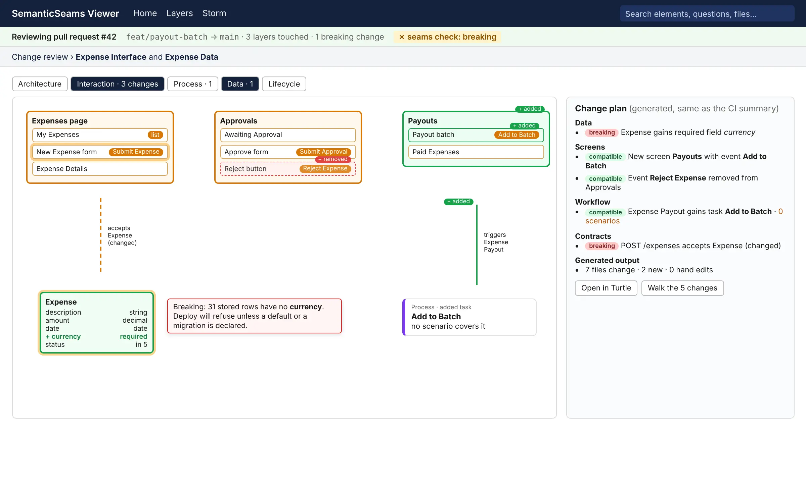

*The same change plan that CI posts on the pull request, drawn on the canvas. Added
elements are green, removed ones red and dashed, and the breaking shape change carries its
consequence for stored rows.*

### 4.8 Runtime heat

Fills: observed behaviour, drift, and dead elements.

With a store and traces present, tint BPMN tasks by open instance count, show state
distribution on the statechart, and badge deployment nodes with `seams status`. The model
doubles as the monitoring surface, and elements nothing ever reaches become visible. This
is the as-observed graph the sequence note deferred, drawn before it is stored.

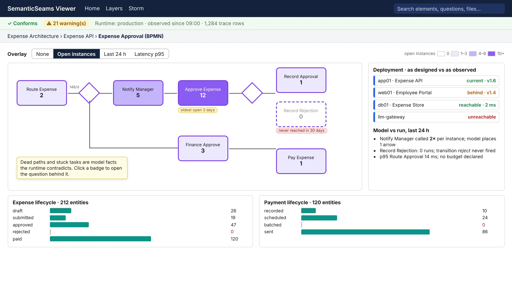

*Tasks tint by open instances, a stuck task and a dead path get badges, deployment nodes
report current, behind or unreachable, and each lifecycle shows how many entities sit in
each state.*

### 4.9 Layers view with focus and context

Fills: the spaghetti at real model sizes.

Default to one traced element with everything else at low opacity. Let a plane collapse
to a bar. Turn the "not drawn" warning into a clickable list.

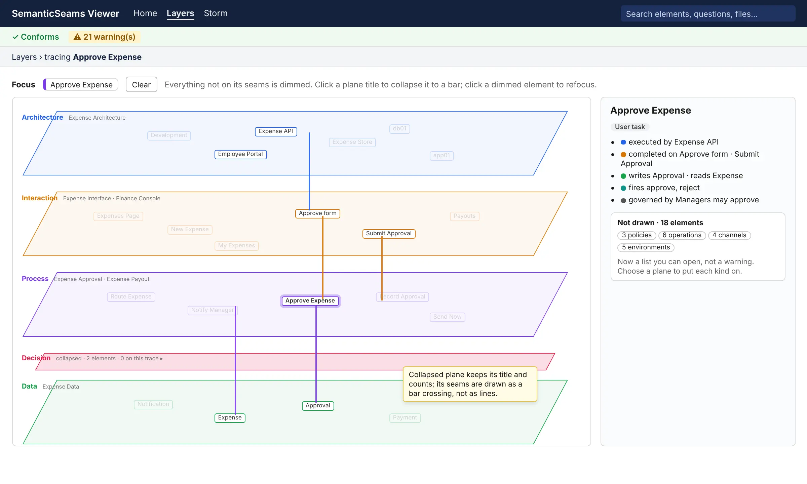

*One element in focus, everything off its seams dimmed, the decision plane collapsed to a
bar, and the undrawn elements listed by kind in the inspector.*

### 4.10 Fix the fundamentals first

Fills: the first five minutes. No mockup needed.

- Fit to view on load for IFML and the shape graph.
- Labels over IRIs in the inspector; the IRI on hover or behind a disclosure.
- The preview pane shows the rendered screen for the selected page, not the file list.
- A search box in the header.

## 5. The one bet

Do 4.1 and 4.2 before any further generator or vocabulary work. The engine can already
carry a much larger audience than the front door lets in, and every milestone from M020
onward deepens the thread for people who have not yet been able to start a model.

## Candidate backlog rows

Not added to the backlog by this note. Each names the query or principle it serves, as
[principle 4](../project/principles.md#_4-vocabulary-is-earned) asks.

| # | Item | Size | Depends on | Vocabulary impact |
|---|---|---|---|---|
| V1 | **Fundamentals** (4.10): fit on load, labels over IRIs, rendered preview, search | S | none | none |
| V2 | **Sentence editing** (4.2): one sentence per element kind, slots as typed pickers, placeholders for missing values; replaces the IRI inputs of I2 | M | I2 | none; labels come from `rdfs:label` and the shapes |
| V3 | **Questions cockpit** (4.3): the question catalog, coverage and gate queries and `seams diff` as the landing page with live counts | S | none | none |
| V4 | **Storm board as capture** (4.1): B4's derived view made editable, each sticky a patch through `seams_edit`, round trip as the acceptance test | L | B4, I1, V2 | none expected; B1 if contexts are drawn |
| V5 | **Thread strip** (4.4): one docked panel joining health, trace index, lock, `seams status`, scenarios and policy tests for the selected element | M | T3 | none |
| V6 | **Role lens** (4.5): a party selector that dims what its policies deny on every renderer | S | none | none |
| V7 | **Scenario player** (4.6): step a scenario through the derived sequence with DMN, lifecycle and payload panels; overlay a trace run | M | U1, U4, U5 | none |
| V8 | **Diff on canvas** (4.7): draw the named-graph diff behind `seams plan` on each renderer | M | A7 | none |
| V9 | **Runtime heat** (4.8): overlays from the store and trace rows on BPMN, statecharts and deployment nodes | M | U4, U9 | the as-observed graph, if stored |
| V10 | **Layers focus** (4.9): focus and context, collapsible planes, undrawn elements as a list | S | item 11 | none |
